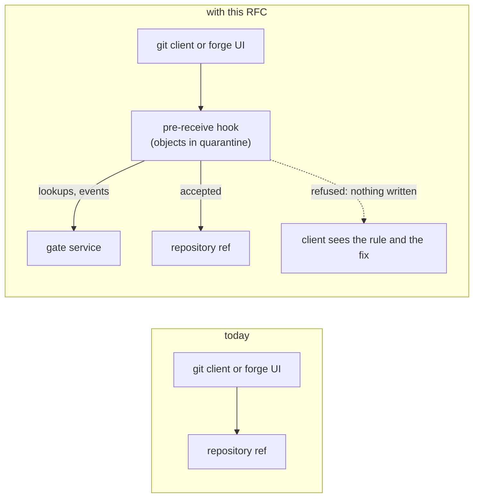
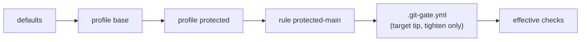
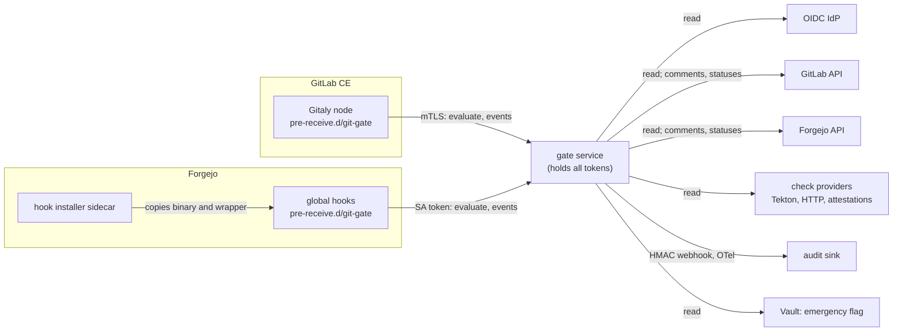
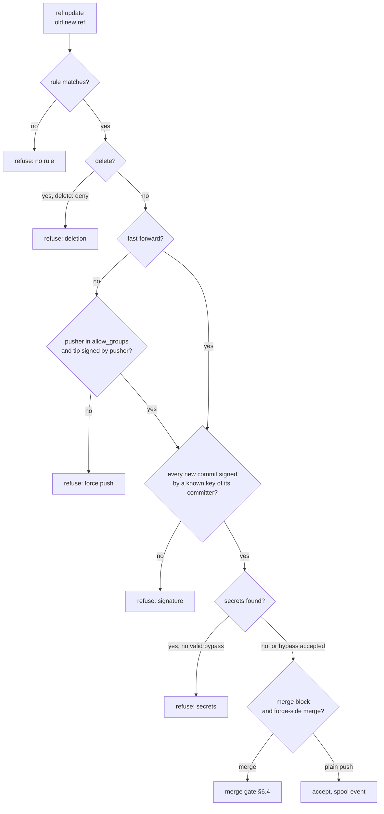
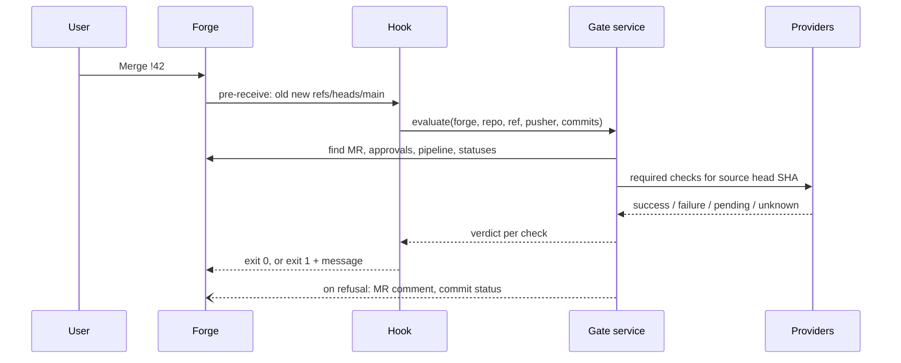
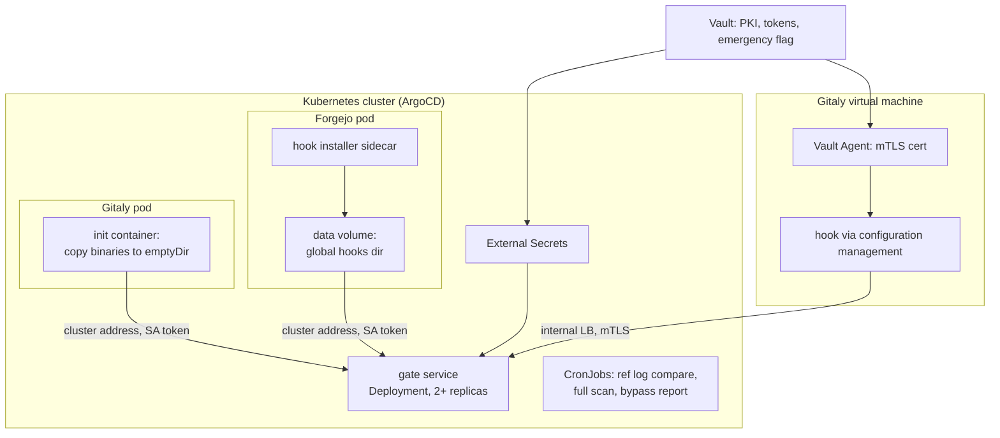
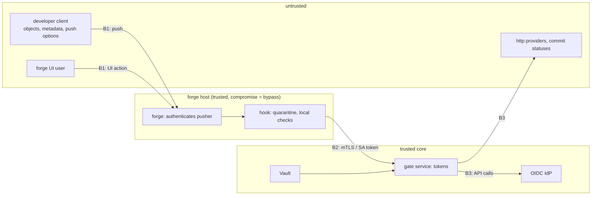

# RFC 0001 — Push and merge policy gate for GitLab CE and Forgejo

| Field       | Value                                                                                   |
| ----------- | --------------------------------------------------------------------------------------- |
| Status      | Draft                                                                                   |
| Short       | git-gate: push and merge policy gate                                                    |
| Settles     | How signatures, force pushes, secrets and merge rules are enforced on both forges       |
| Author      | @Maxime                                                                                 |
| Co-author   | Claude Opus 5.5                                                                         |
| Created     | 2026-11-17                                                                              |
| Supersedes  | —                                                                                       |
| Touches     | new: hook binary, gate service, Forgejo hook installer, Gitaly init container, Helm chart, policy repository; `docs/RFC`, `docs/readme.md` |
| Risk        | high (§7)                                                                               |

> **Reference material.** About 20 000 words. A first read needs §1, §2, §3,
> §7.1 and §15; the rest is the detail a reviewer checks against.

---

## 1. Summary

`git-gate` (working name) is a single policy binary that runs as a `pre-receive`
hook on both GitLab CE and Forgejo. It rejects any push that breaks a
configurable rule: unsigned commits, force pushes without an admin signature, or
leaked secrets. Anything no rule covers is refused.

Identity comes from the forge, group membership from the OIDC identity provider
(IdP; authentik in the examples, any OIDC provider in production), and trusted
keys from the forge plus Sigstore. Bypasses are limited to named groups and
always produce an audit event.

Merge rules reuse the same hook: a merge is a push to the target branch, so the
gate checks the merge request before accepting it. A central gate service holds
every token; the hook on the forge host holds none.

### Before / after

```text
# today: an unsigned commit pushed straight to main
$ git push origin main
To git.example.internal:weebo-si/platform.git
   3f1c2a0..9ab2e41  main -> main

# with this RFC
$ git push origin main
remote: GL-HOOK-ERR: [protected-main] signature: commit 9ab2e41 is not signed.
remote: GL-HOOK-ERR: Fix: sign it (git commit --amend -S) and push again. Guide: https://docs.example.internal/git-gate/signing
To git.example.internal:weebo-si/platform.git
 ! [remote rejected] main -> main (pre-receive hook declined)
error: failed to push some refs to 'git.example.internal:weebo-si/platform.git'
```



Every ref update, from a client or from the forge's own UI, now crosses the
hook; a refused update leaves no object and no ref behind.

---

## 2. Motivation

1. **Approvals do not block merges on GitLab CE.** On the Free tier approvals
   are optional; required approvals need Premium [R2]. Today a merge request on
   a protected branch can be merged by anyone with merge rights and no approval.
   The per-project "pipelines must succeed" setting, where a project enables it,
   still lets through jobs marked "allowed to fail" and cannot require a named
   external check (author's reading, not cited).
2. **Nothing on the server ties a commit to the person who pushed it.** No rule
   on our instances refuses an unsigned commit. Forgejo can require signed
   commits per branch [R8], but only with keys it knows, so gitsign signatures
   fail it; on GitLab CE we know of no server-side rule. A commit's author and
   committer fields are free text. A commit on `main` today can claim any
   identity, and an incident review cannot tell who committed it. (Authorship
   stays unproven with this RFC too: the gate binds the committer, §6.4.)
3. **Force push is a role, not an act.** Branch protection on both forges allows
   or denies force push per role. A maintainer's stolen session can rewrite
   `main`, and nothing records which human approved the rewrite.
4. **Secret scanning is client-side only.** The gitleaks pre-commit hook in our
   repositories is skipped by `git commit --no-verify`, by any client without
   the hook installed, and by every web UI edit. A secret is found, if at all,
   after it is in history.
5. **Two forges, two configurations.** GitLab CE and Forgejo express protection
   differently and partially. The same rule ("main needs a review and a green
   build") is written twice, drifts, and on GitLab CE cannot be written at all
   (point 1).
6. **No audit trail of exceptions.** When a rule is bypassed today (an admin
   unprotects a branch for a minute), nothing records who, why or what entered
   meanwhile.

---

## 3. Goals / non-goals

**Goals**

- One policy and one binary for GitLab CE (self-managed) and Forgejo.
- Every check is configurable per repository and per ref (on, off, audit only,
  parameters, bypass), with default deny on rule matching.
- Signed commits required, accepting GPG, SSH and Sigstore (gitsign) signatures.
- Force push only by a member of an admin group whose own key signed the tip
  commit.
- Pushes containing secrets are blocked; a traced bypass exists for named groups
  only.
- Merge rules enforced at the same choke point as push rules.
- Every decision is auditable through a webhook and OpenTelemetry.

**Non-goals**

- A network proxy in front of the forges: the hook sees the same data with far
  less surface (§12).
- Replacing forge permissions: the gate only adds refusals; it never grants
  access.
- Client-side hooks as enforcement: they are a courtesy for developers, bypassed
  by `--no-verify`.
- Scanning existing history in the hook: the hook inspects only what a push
  adds; a separate scheduled job scans history (§6.8).
- Replacing CI: the gate reads CI results, it never runs builds or scanners
  itself.
- Managing developers' keys or Sigstore setup: the gate verifies; `git-gate
  doctor` only diagnoses.
- GitHub as a forge: `github_actions` is only a source of check results (§6.4).

### Success criteria

The gate succeeds if it is fast enough to go unnoticed, closes the gaps it
targets, and stays easy for developers to live with. The targets below are
proposals, to be calibrated against the baseline measured during the audit-mode
phase (§10.3, Q20).

| Area | Criterion | Proposed target | Measured by |
| --- | --- | --- | --- |
| Latency | Time the hook adds to an ordinary push (up to 10 commits) | p95 under 1.5 s and p99 under 4 s with GPG or SSH signatures; p95 under 2.5 s with Sigstore signatures | Hook duration histogram |
| Latency | Time the hook adds to a merge | p95 under 3 s | Hook duration histogram, merge events |
| Latency | Gate service lookup | p95 under 100 ms | Service request metrics |
| Latency | Large push (1,000 commits) | Decided in under 30 s, or refused with a clear message | Load test before rollout |
| Security | Commits entering a protected ref that are signed and tied to an IdP identity | 100% | Audit events |
| Security | Ref updates made outside the gate | 0 unexplained tips | Ref log comparison job |
| Security | Secrets that entered after enforcement without a recorded bypass | 0 | Periodic full scan |
| Security | Bypasses and exemptions with a reason, an alert and an audit event | 100% | Bypass report |
| Security | Long-lived secrets stored on forge hosts | 0 | Host configuration review |
| Security | Policy changes merged without review and passing policy tests | 0 | Policy repository history |
| Developer experience | Refusals that turn out to be wrong | Under 1% of refusals | Bypass reasons and developer reports |
| Developer experience | Refusal messages that name the rule and the fix | 100% | Review of message templates (§4.5), policy tests |
| Developer experience | Same verdict from `git-gate check` locally and from the server | At least 99% | Comparison in audit events |
| Developer experience | Time for a new developer to get a first accepted push | Under 15 minutes with `git-gate doctor` | Onboarding trial |
| Developer experience | Secret findings that are false positives | Under 5% | Bypass reasons |
| Reliability | Pushes blocked by a fault of the gate itself | Under 45 minutes per month (99.9%) | Service and hook error metrics |
| Reliability | A service outage shorter than the cache lifetime | No push refused for a pusher whose keys and email are cached and whose rule matches no group; merges, group-dependent actions and uncached pushers are refused (§10.2) | Failure test before rollout |
| Reliability | Emergency switch takes effect | Under 5 minutes | Drill |
| Reliability | Upgrade of service and hooks | No push interrupted | Upgrade on the pilot |
| Coverage | Repositories with the hook installed | 100%, including a Forgejo repository created a second ago (global hook directory) | Hook installer alert, ref log comparison |
| Coverage | Decisions with a delivered audit event | 100%, none lost during a sink outage | Spool and sink counters |
| Configurability | A rule or parameter change goes live without code change or redeploy | Under 5 minutes after merge | Policy revision in audit events |
| Configurability | A new external check source | Added in the service only, no hook release | Release notes |

---

## 4. User-facing design

### 4.1 Configuration

Rules live in one YAML file in a dedicated repository, itself protected by the
gate.

```yaml
version: 1
defaults:
  on_no_match: deny
  mode: enforce                # enforce | audit | off; overridable per profile, rule and check
identity:
  match_by: email
sigstore:                      # self-hosted instance
  fulcio_root: /etc/git-gate/fulcio-root.pem
  rekor_url: https://rekor.example.internal
  oidc_issuer: https://authentik.example.internal/application/o/sigstore/
  rekor_online: allow          # allow | deny: signatures without an embedded Rekor proof (§6.2)
groups:                        # aliases for IdP group names
  admins: git-admins
  secret_bypass: git-secret-bypass
  ci_owners: git-ci-owners
  release_managers: git-release-managers
repo_overrides:                # checks a repository's own .git-gate.yml may tighten
  allow: [forbidden_files, conventions, protected_paths]

profiles:                      # reusable bundles; a rule lists the ones it uses
  base:
    signature: { required: true, types: [gpg, ssh, sigstore], web_commits: deny }
    secrets:
      bypass: { groups: [secret_bypass] }
    git_hardening: { fsck: strict, bidi_characters: deny, case_collisions: deny }
    forbidden_files:
      patterns: ["**/.env", "**/*.pem", "**/kubeconfig"]
      max_size: 10MiB
      require_lfs: ["**/*.zip", "**/*.jar"]
    commit_dates: { max_future: 10m, max_age: 180d }
  protected:
    signature: { web_commits: instance_signed, min_key_age: 24h }
    force_push: { allow_groups: [admins], require_pusher_signed_tip: true }
    delete: deny
    protected_paths:
      paths: [".gitlab-ci.yml", ".forgejo/workflows/**", "CODEOWNERS"]
      approver_groups: [ci_owners]

rules:
  - name: non-code-repos       # first: a wiki also has refs/heads/main
    match: { kind: [wiki, design, snippet] }
    secrets:
      bypass: { groups: [secret_bypass] }
    forbidden_files: { patterns: ["**/.env", "**/*.pem", "**/kubeconfig"], max_size: 10MiB }
  - name: protected-main
    match: { forge: [gitlab, forgejo], repo: "weebo-si/*", ref: "refs/heads/main" }
    profiles: [base, protected]
    merge:
      require_merge_request: true
      min_approvals: 1
      approver_groups: [admins]
      approvals_exclude_committers: true
      reset_approvals_on_push: true
      up_to_date_with_target: true
      pipeline: { require_success: true, require_complete: true }
      required_checks: [build, sonarqube, dependency-check, sbom]   # defined under "checks" (§6.4)
      require_signed_commits: true
      sign_off: { match: committer, require_author: false }
    freeze:
      windows: [{ from: "2026-12-21", to: "2027-01-04" }]
      bypass: { groups: [admins] }
  - name: release-tags
    match: { repo: "**", ref: "refs/tags/v*" }
    profiles: [base]
    tags:
      immutable: true
      annotated: true
      signed: true
      pattern: '^v\d+\.\d+\.\d+$'
      create_groups: [release_managers]
  - name: agit-proposals       # Forgejo AGit: git push origin HEAD:refs/for/main
    match: { forge: [forgejo], repo: "**", ref: "refs/for/**" }
    profiles: [base]
  - name: feature-branches
    match: { repo: "**", ref: "refs/heads/**" }
    profiles: [base]
    force_push: { allow: true }
    conventions:
      mode: audit              # logged, not refused, while teams adapt
      commit_message: '^(feat|fix|chore|docs|refactor|test)(\(.+\))?: .+'
      branch_name: '^(feat|fix|chore)/.+'
      submodule_urls: ["https://git.example.internal/**"]
```

Every control is a check, and nothing is hard-coded. Each check takes its own
parameters plus the same four settings:

| Setting | Effect | Absent |
| --- | --- | --- |
| `mode` | `enforce` refuses, `audit` only logs, `off` disables | Inherited; `defaults.mode` is `enforce` |
| `bypass` | Groups allowed to skip the check; a reason is always required | The check has no bypass |
| `message` | Text shown to the developer on refusal, for example a link to the internal guide | A generic fix line per check |
| `exempt` | Pushers, groups or paths the check ignores, for example a release bot | Nobody is exempt |

Settings are layered, and the later layer wins: `defaults`, then each profile in
the order the rule lists them, then the rule itself, then the repository's
`.git-gate.yml` (tighten only).



The diagram shows that a repository file is the last layer and can only add
strictness: it never sees a check outside `repo_overrides.allow`.

Defaults and the safe side:

- `on_no_match: deny` is the closed side: a ref no rule covers is refused.
- `bypass` absent means no bypass, the closed side.
- `exempt` absent means nobody is exempt. Every exempt hit still writes an audit
  event with `exempt: <entry>`, so an exemption is never silent.
- **A check that no layer mentions is off.** This is the open side, bounded by
  validation (Q7): a rule that protects a ref (a `merge` block, `delete: deny`
  or `force_push.allow_groups`) is rejected unless it enables `signature` and
  `secrets`. Elsewhere, a missing check is the rule author's visible choice.
- `mode: audit` anywhere is reported as a warning (§4.3), because it is a silent
  open door on a protected ref.

On each forge host, `/etc/git-gate/hook.toml` holds only the forge type, the
service URL, the credential path, cache and spool directories and time budgets.
No policy lives on the host.

### 4.2 Behaviour rules

- **Matching.** Rules match on `forge`, `repo` and `ref`, and optionally on
  `event` (`push`, `merge`, `tag`, `delete`) and `pusher_groups`. Paths and refs
  are globs; names and messages are regular expressions. The first rule that
  matches wins, so order is load-bearing (§4.3 warns on shadowed rules).
- **Absent and empty.** An absent `match` key matches everything (`release-tags`
  above applies to both forges). An empty list (`forge: []`) is a validation
  error, never "match nothing". `kind` is one of `code`, `wiki`, `design`,
  `snippet` (Q34); absent means all four, which is why `non-code-repos` comes
  first. On GitLab the kind comes from the `GL_REPOSITORY` prefix: `project-`,
  `wiki-` and `group-<id>-wiki` (group wikis), `design-`, `snippet-` [R6]; an
  unknown prefix is refused. On Forgejo, `GITEA_REPO_IS_WIKI` tells a wiki from
  code; Forgejo has no design or snippet repositories [R8].
- **Tags** use the same matching on `refs/tags/**`.
- **Repository file.** A repository can carry its own `.git-gate.yml`. It can
  only tighten the checks named in `repo_overrides.allow`, never loosen or
  disable one. It is read from the current tip of the target ref, not from the
  pushed commits, so a push cannot relax its own rules. When the target ref is
  new, the file is read from the tip of the repository's default branch; if it
  is absent there, no override applies (Q8).
- **`sign_off`** can also be set at rule level, next to `signature`, to check it
  at push time and not only at merge.
- **The uninteresting case.** A push that matches a rule and passes every check
  is accepted with no output beyond Git's own, and writes one `push.accepted`
  event. A rule whose checks are all `off` accepts every push to its refs and
  still writes the event.
- **Push options.** Only `gate.bypass` and `gate.reason` are read. Other options
  are ignored. A `gate.bypass` naming a check that has no `bypass` block refuses
  the push with that reason, so a mistyped bypass never silently does nothing.
- **Several refs in one push.** Each ref is decided against its own rule; the
  first refusal refuses the whole push, as Git does for a declining
  `pre-receive` hook.
- **Policy changes** go through a merge request on the policy repository, so the
  gate's own rules apply to them. The schema is versioned, and an unknown key is
  an error.

### 4.3 Validation

Validation runs in three places with the same code: `git-gate policy test` in
the policy repository's pipeline, the hook on any push to the policy repository,
and the service when it loads a revision. A revision that fails is never loaded;
the service keeps the last good one.

Rejected (hard errors):

| Condition | Rationale |
| --- | --- |
| Unknown key, or unknown `version` | A typo in a security key must not silently disable it |
| A regular expression or glob that does not compile | The check would fail at push time instead of at review time |
| A `profiles`, group alias or `required_checks` name with no definition | A missing check would pass by omission |
| An empty `match` list | "Match nothing" is never what the author meant |
| An `http` provider URL whose host is not on the service allowlist | Request forgery from the token-holding service (T11) |
| A `bypass` block on `signature`, `force_push` or `delete` | These checks have no bypass by design (§6.1) |
| A rule with a `merge` block, `delete: deny` or `force_push.allow_groups` that does not enable `signature` and `secrets` | A protection rule without them is almost always a copy-paste error (Q7) |
| A rule with `require_merge_request: true` without `up_to_date_with_target: true` | GitLab squash merges are matched by tree, which holds only when the source contains the target tip (Q22) |
| A policy test whose expected decision differs | The change breaks a pinned behaviour |

Warnings, and where the operator sees them:

| Condition | Behaviour | Surfaced in |
| --- | --- | --- |
| A rule shadowed by an earlier rule that matches all its refs | Loaded; the later rule never applies | `git-gate policy test` output in the policy MR, and a `git-gate` commit status set to `failure` with the list, so the MR shows it |
| `mode: audit` or `off` on a rule with a `merge` block | Loaded | Same, plus an alert "loosening change" on merge (T13) |
| A check with `combine: any` and a single source | Loaded; `any` and `all` are identical | `git-gate policy test` output |
| A check using `combine: any` on a rule with a `merge` block | Loaded | `git-gate policy test` output, citing T14 |

### 4.4 API surface

The hook-to-service API is internal and versioned; the service accepts the
current and the previous hook version. The spec is generated with utoipa and
served with Scalar on the service's internal port. Paths are indicative until
phase 1.

| Method | Path | Auth | Who may call | Limit |
| --- | --- | --- | --- | --- |
| `POST` | `/v1/evaluate` | mTLS (Vault PKI) or projected service account token | Forge hosts; the certificate's forge must equal the request's forge | Per-host concurrency cap |
| `POST` | `/v1/events` | Same | Forge hosts | Body size cap; batch size cap |
| `GET` | `/v1/policy` | Same, read only | Forge hosts only; developers read the policy repository (Q15) | Per-caller rate limit |
| `POST` | `/v1/webhooks/{forge}` | The forge's webhook secret, compared in constant time | The forges (merge request events for `preflight`) | Rate limit; payload is a trigger only, the service re-reads state from the API |

### 4.5 Mocks

Refusal lines are prefixed `GL-HOOK-ERR:` on GitLab so they also appear in the
web UI [R1]; Forgejo shows plain `remote:` lines. Colours are Git's own; the
hook prints no ANSI codes, so messages read the same in the web UI and in logs.

**`git push` — refused, signature (GitLab, SSH)**

```text
$ git push origin main
remote: GL-HOOK-ERR: [protected-main] signature: commit 9ab2e41 is not signed.
remote: GL-HOOK-ERR: Fix: sign it (git commit --amend -S) and push again. Guide: https://docs.example.internal/git-gate/signing
To git.example.internal:weebo-si/platform.git
 ! [remote rejected] main -> main (pre-receive hook declined)
error: failed to push some refs to 'git.example.internal:weebo-si/platform.git'
$ echo $?
1
```

Decides the two-line shape: rule and check first, then one actionable fix and
the guide link.

**`git push` — refused, secret (Forgejo, HTTPS)**

```text
$ git push origin feat/login
remote: [feature-branches] secrets: 1 finding in the pushed commits.
remote:   src/config.rs:12  generic-api-key  (commit 77d0c3e)
remote: Fix: remove it from every commit (git rebase -i), then rotate it: it has reached the server and must be treated as exposed.
remote: False positive? git push -o gate.bypass=secrets -o gate.reason="<why, ticket>"  (group git-secret-bypass only)
To https://forgejo.example.internal/weebo-si/platform.git
 ! [remote rejected] feat/login -> feat/login (pre-receive hook declined)
error: failed to push some refs to 'https://forgejo.example.internal/weebo-si/platform.git'
```

Decides that the finding shows file, line, detector and commit, never the value,
and that the rotation advice is part of every secret refusal.

**`git push` — bypass accepted**

```text
$ git push -o gate.bypass=secrets -o gate.reason="test fixture, OPS-123" origin feat/login
remote: [feature-branches] secrets: bypassed by alice, reason "test fixture, OPS-123". 1 finding waived. Security has been notified.
To https://forgejo.example.internal/weebo-si/platform.git
   1c9e004..77d0c3e  feat/login -> feat/login
```

Decides that an accepted bypass is visible to the pusher and says that it was
reported.

**`git push` — bypass refused (not in group, or no reason)**

```text
remote: GL-HOOK-ERR: [feature-branches] secrets: bypass refused: bob is not in git-secret-bypass.
 ! [remote rejected] feat/login -> feat/login (pre-receive hook declined)
```

**`git push` — gate unavailable (fail closed)**

```text
remote: GL-HOOK-ERR: git-gate could not reach its policy service and has no valid cached answer. The push was refused to stay safe.
remote: GL-HOOK-ERR: Nothing is wrong with your commits. Retry in a few minutes; status: https://status.example.internal
 ! [remote rejected] main -> main (pre-receive hook declined)
```

Decides that an infrastructure refusal says so plainly and does not blame the
commits.

**`git push` — emergency switch active**

```text
remote: GL-HOOK-ERR: git-gate is in emergency audit mode until 14:05 UTC. This push would have been refused: [protected-main] signature: commit 9ab2e41 is not signed.
To git.example.internal:weebo-si/platform.git
   3f1c2a0..9ab2e41  main -> main
```

Decides that audit mode, emergency or not, still tells the pusher what would
have been refused.

**GitLab UI — merge refused**

```text
┌─ Merge request !42 ─────────────────────────────────────────────────┐
│ ✖ Merge failed: GL-HOOK-ERR: [protected-main] merge: 2 checks       │
│   failed. See the git-gate comment below.                           │
└─────────────────────────────────────────────────────────────────────┘
```

The second sentence appears only when a comment is posted: with the service
unreachable, the line carries the "gate unavailable" text above instead. Whether
GitLab strips the `GL-HOOK-ERR:` prefix in this banner is checked on the pilot.

**Merge request comment (bot account), refused**

```text
### git-gate: merge refused
Rule `protected-main` · policy revision `c41d9e2`

| Check | Result | Fix |
| --- | --- | --- |
| `sonarqube` | no result for commit `9ab2e41` | Re-run the analysis on the latest commit |
| approvals | 0 of 1 from `git-admins` | Ask a member of git-admins to approve |

<details><summary>6 checks passed</summary> … </details>

Guide: https://docs.example.internal/git-gate/merge
```

Decides one table of failures with fixes, passed checks collapsed, the revision
for reproducibility. With `strategy: update` the same comment is edited on each
attempt. Text from commits is escaped (§7.3).

**`git push` — no rule covers the ref (default deny)**

```text
$ git push origin refs/notes/commits
remote: GL-HOOK-ERR: no git-gate rule covers refs/notes/commits in weebo-si/platform, so it is refused by default.
remote: GL-HOOK-ERR: Fix: push to a covered ref, or ask the policy owners to add a rule. Guide: https://docs.example.internal/git-gate/rules
 ! [remote rejected] refs/notes/commits -> refs/notes/commits (pre-receive hook declined)
```

Decides that default deny names the ref and the repository, and points to the
policy owners rather than to the commits.

**`git push --force` — refused**

```text
remote: GL-HOOK-ERR: [protected-main] force_push: bob is not in git-admins.
remote: GL-HOOK-ERR: [protected-main] force_push: tip 4e1a0c2 is signed by alice, not by the pusher bob. Fix: sign the tip yourself (git commit --amend -S --no-edit).
 ! [remote rejected] main -> main (pre-receive hook declined)
```

Two variants, one per condition; the second appears only for members of the
group.

**`git push` — tag refused**

```text
remote: [release-tags] tags: v1.4.0 is a lightweight tag; release tags must be annotated and signed → git tag -s v1.4.0
 ! [remote rejected] v1.4.0 -> v1.4.0 (pre-receive hook declined)
```

**`git push` — push over budget**

```text
remote: GL-HOOK-ERR: [protected-main] secrets: the scan did not finish within 20 s for 1,240 commits. Nothing is wrong with your commits; split the push into smaller ones.
 ! [remote rejected] main -> main (pre-receive hook declined)
```

**`git push` — mistyped bypass**

```text
remote: [feature-branches] bypass refused: "secret" is not a check with a bypass here. Checks with a bypass: secrets.
 ! [remote rejected] feat/login -> feat/login (pre-receive hook declined)
```

**`git push` — audit mode (rollout, or a check in `mode: audit`)**

```text
remote: [feature-branches] conventions (audit): commit 77d0c3e message does not match '^(feat|fix|chore|docs|refactor|test)(\(.+\))?: .+'. This will be refused once the rule is enforced.
To https://forgejo.example.internal/weebo-si/platform.git
   1c9e004..77d0c3e  feat/login -> feat/login
```

Decides that audit mode is visible to the pusher, one line per check, so teams
adapt before enforcement.

**GitLab web editor — commit refused (`web_commits: deny`)**

```text
┌─ Edit file: README.md ──────────────────────────────────────────────┐
│ ✖ GL-HOOK-ERR: [protected-main] signature: commits made in the web  │
│   editor are not accepted on main. Push from a client with your own │
│   signature, or open a merge request from a branch.                 │
└─────────────────────────────────────────────────────────────────────┘
```

**Forgejo UI — merge refused**

```text
┌─ Pull request #17 ──────────────────────────────────────────────────┐
│ ✖ Merge failed: [protected-main] merge: approvals 0 of 1 from       │
│   git-admins. See the git-gate comment below.                       │
└─────────────────────────────────────────────────────────────────────┘
```

**`git-gate policy test` — pass, failing case, error, warning**

```text
$ git-gate policy test
policy c41d9e2 · 3 rules · 24 cases
OK    24/24 cases
$ echo $?
0

FAIL  case "unsigned push to main is refused": expected refused, got accepted (rule feature-branches matched first)
ERROR rules[1].checks.sonarqube: unknown key "mode" (did you mean "combine"?)
WARN  rule feature-branches is shadowed by rule all-branches for every ref it matches
1 failed, 1 error, 1 warning. Exit 1.
```

Decides that a warning in policy test fails the policy merge request like an
error: the policy repository is the one place where a silent shadowed rule costs
most.

**Exit codes for `git-gate check` and `git-gate doctor`**

| Code | Meaning |
| --- | --- |
| 0 | Accepted, or nothing to push, or ready (warnings may be printed) |
| 1 | Would be refused, or a setup problem was found |
| 2 | The tool could not run: no forge credential, policy repository unreachable, not a Git repository |

`check` and `doctor` use the developer's existing Git credential for the forge
(the credential helper `git push` already uses); with none, they exit 2 with `no
credential for git.example.internal; run git push once or configure a credential
helper`.

**`git-gate check` — nominal and refused**

```text
$ git-gate check
Policy c41d9e2 · rule protected-main · 3 commits to push
✔ OK    signature        3/3 signed (ssh), committer alice@example.org
✔ OK    secrets          no finding
✔ OK    git_hardening    no finding
✔ OK    forbidden_files  no finding
✔ OK    commit_dates     3/3 within limits
Server verdict expected: accepted
$ echo $?
0

$ git-gate check
Policy c41d9e2 · rule protected-main · 1 commit to push
✖ FAIL  signature        9ab2e41 is not signed → git commit --amend -S
Server verdict expected: refused
$ echo $?
1
```

**`git-gate doctor` — nominal and error; `git-gate check` — nothing to push**

```text
$ git-gate doctor
✔ OK    user.email alice@example.org matches your forge account
✔ OK    signing: ssh key ~/.ssh/id_ed25519.pub registered on gitlab (added 2026-10-02)
✔ OK    commit.gpgsign = true
Ready.

$ git-gate doctor
✖ FAIL  user.email alice@users.noreply.example.internal is a no-reply address; the gate refuses it → git config user.email alice@example.org
✖ FAIL  signing: no signing key configured → https://docs.example.internal/git-gate/signing
⚠ WARN  gitsign: GITSIGN_REKOR_MODE is online; accepted for now, set it to offline → export GITSIGN_REKOR_MODE=offline
2 problems, 1 warning. Exit 1.

$ git-gate check
Nothing to push: HEAD is already on origin/main.
```

---

## 5. Architecture

Both forges run the same binary as a `pre-receive` hook. The hook does
everything that needs the Git objects; a central gate service holds the tokens
and answers every lookup.

- **Hook binary.** A static Rust executable. Git calls it with `old new ref`
  lines on stdin while the pushed objects sit in quarantine, so a refusal leaves
  nothing behind [R14]. It verifies signatures, detects force pushes and runs
  the secret scan locally.
- **Gate service.** A stateless HTTP service with at least two replicas. It is
  the only component holding the IdP token, the forge API tokens and the webhook
  key. It serves the policy, group membership, user keys and emails, and merge
  request state, all cached in memory by each replica with a short TTL. It also
  receives audit events and forwards them, and runs the check providers.
- **Hook to service.** Each forge host authenticates with its own short-lived
  mTLS certificate issued by Vault PKI. The certificate names the forge, so a
  GitLab host cannot query Forgejo context. Where a forge runs in the cluster, a
  projected service account token is an accepted equivalent. That credential
  only allows read lookups and event submission.
- **GitLab CE adapter.** Installed once as a global server hook in
  `<custom_hooks_dir>/pre-receive.d/` on each Gitaly node [R1]. Context comes
  from `GL_USERNAME`, `GL_PROJECT_PATH`, `GL_PROTOCOL` and `GL_REPOSITORY` [R1].
- **Forgejo adapter.** Installed once in Forgejo's global hook directory,
  `<[git] HOME_PATH>/hooks/pre-receive.d/`, which the hook Forgejo generates in
  every repository runs before the repository's own `pre-receive.d` [R7].
  Context comes from `GITEA_PUSHER_NAME`, `GITEA_REPO_USER_NAME`,
  `GITEA_REPO_NAME`, `GITEA_REPO_IS_WIKI`, `GITEA_PR_ID`, `GITEA_PUSH_TRIGGER`,
  `GITEA_DEPLOY_KEY_ID` and `SSH_ORIGINAL_COMMAND` [R8].

### 5.1 Wiring



This proves the hook never talks to a provider directly: every token sits behind
one service, so a compromised forge host gains read lookups and event
submission, nothing else.

### 5.2 Push decision

For each updated ref the hook resolves the matching rule, computes the new
commits, then runs the checks from cheapest to most expensive. The first failure
refuses the whole push.



This shows that every path not ending in `accept` is a refusal, and that no
check can be reached without first matching a rule.

### 5.3 Merge



This shows that providers are reached only by the service, and that the comment
is written after the verdict, so feedback never delays or changes the decision.

### 5.4 Invariants

- Because the hook runs while the pushed objects are in quarantine, a refused
  push leaves no object and no ref in the repository.
- Because only the service holds the forge, IdP and provider tokens, a
  compromised forge host gains no credential beyond what that host already
  holds: it can ask the service questions and submit events. It can still bypass
  the gate on that host (T3).
- Because `.git-gate.yml` is read from the target tip and never from the pushed
  commits, a push cannot relax its own rules.
- Because the pusher is taken from the forge's authentication and never from
  commit metadata, a commit cannot claim another identity for group rules.

---

## 6. Detailed design

There is no code yet; the symbols below are names proposed for phase 1.

### 6.1 Hook binary

- **Objects.** The hook reads objects in-process. It must honour the quarantine
  environment Git sets for `pre-receive`: `GIT_OBJECT_DIRECTORY` and
  `GIT_QUARANTINE_PATH` point at the temporary directory, and
  `GIT_ALTERNATE_OBJECT_DIRECTORIES` at the real object store [R14]; a reader
  that ignores them sees none of the pushed objects and would refuse everything,
  or worse, read a stale object. A test pushes a new blob and checks the hook
  can read it (§14).
- **New commits.** The range is `old..new`, or `new --not --all` for a new ref.
  Commits already reachable from a ref that has a `merge` block are skipped,
  because they were checked when they entered that ref; without this, a feature
  branch that merges `main` would be refused for carrying `main`'s
  instance-signed merge commits. In both forms, only refs under `refs/heads/`
  and `refs/tags/` are considered, which keeps the walk cheap on GitLab
  repositories with many `keep-around` and `merge-requests` refs; and only refs
  whose rule enforces `signature` and `secrets` count for the exclusion (Q6):
  commits reachable only from refs under weaker rules (audit mode, `off`,
  `non-code-repos`) are checked again. Commits that entered an enforcing ref
  through a bypass or the emergency switch are not rechecked; they are already
  in the audit trail.
- **Force push.** A non-fast-forward is detected when `git merge-base
  --is-ancestor old new` fails. A commit signature proves who committed, not who
  pushed. The rule therefore needs both: the forge-authenticated pusher is in
  the admin group, and the tip commit carries that same user's signature. An
  admin's signed commit pushed by someone else is refused. A consequence:
  rewinding a branch to an older commit signed by someone else is refused; the
  admin rolls back with a new signed commit (a revert, or an empty signed commit
  on top of the target).
- **Ref deletion.** Refused when the rule says `delete: deny`. No bypass.
- **Secrets.** Gitleaks scans only the pushed range. The refusal lists file,
  line and detector name, never the secret itself. Scanner output is parsed in
  memory and never written to a log.
- **Bypass.** A member of a bypass group can skip the secrets check with push
  options:

```sh
git push -o gate.bypass=secrets -o gate.reason="false positive, ticket OPS-123"
```

The hook reads them from `GIT_PUSH_OPTION_COUNT` and `GIT_PUSH_OPTION_<i>` [R1].
A bypass without a reason, or from a user outside the group, is refused. Every
accepted bypass emits a high-severity `bypass.used` event that includes the
findings it waived (detector, file, line, never the value), and that event is
durably spooled, marked pending, before the push is accepted; the `post-receive`
record of the ref update confirms it, so a bypass whose push never landed stays
marked pending in the report. Signature, force-push and deletion checks have no
bypass, and validation rejects a `bypass` block on them (§4.3).

| Check | Refuses when | Bypass |
| --- | --- | --- |
| Rule match | No rule matches the repository and ref | None |
| Signature | Any new commit is unsigned, fails verification, or is signed by an unknown key | None |
| Force push | The update is not a fast-forward and the pusher is not in an allowed group, or the tip commit is not signed by the pusher's own key | None |
| Ref deletion | The rule says `delete: deny` | None |
| Secrets | The scanner finds a secret in the new commits | Named groups, with a reason |

- **Messages.** Refusals print the rule name and the fix (§4.5). On GitLab each
  line is prefixed with `GL-HOOK-ERR:` [R1].
- **Budgets.** Each check has a time budget from `hook.toml`; a check that
  exceeds it refuses with a message asking to split the push.

### 6.2 Identity and trust

The pusher is whoever the forge authenticated; the gate maps that account's
email to the IdP and never trusts commit metadata for identity.

**Email mapping.** The email is read from the forge account, never from the
commit, and always by the service through the forge API (Q17). GitLab exposes
only `GL_ID` and `GL_USERNAME` to hooks [R1], and Forgejo omits
`GITEA_PUSHER_EMAIL` when the user keeps the address private [R8], so the hook
environment is never used for it. GitLab returns `email` only to an
administrator token with `read_user`, plus `admin_mode` when Admin Mode is on
[R6]; Forgejo needs an administrator token too. Both tokens are read-only and
used for nothing else (Q11, Q36). This holds under three conditions, which are
rollout prerequisites (§13):

- Both forges create users from the IdP OIDC and take the email from its claim.
- Local account creation is disabled on both forges.
- Users cannot take another person's email (Q12). On GitLab,
  `sync_profile_from_provider` with `email` in `sync_profile_attributes` makes
  it read-only [R6]. Forgejo has no such setting [R8]:
  `REGISTER_EMAIL_CONFIRM=true` creates new addresses unconfirmed,
  `EMAIL_DOMAIN_ALLOWLIST` limits addresses to company domains, an address can
  belong to one account only [R9], and a scheduled job alerts when a Forgejo
  email differs from the IdP's. The "confirmed before primary" rule is enforced
  only in the web page, not in the server handler, so a forged request may make
  an unconfirmed address primary [R9] (inferred from code, not tested); because
  addresses are unique, this can only claim the address of someone with no
  Forgejo account yet. The gate closes it (Q39): the service reads the pusher's
  addresses with the administrator token and refuses a pusher whose primary
  address is not confirmed; which API call exposes that flag is settled in phase
  2. The IdP must assert verified, unique email addresses: authentik, for
     instance, sets `email_verified` to `false` by default since 2025.10 and
     says it has no authoritative verification status [R16], so the IdP needs an
     email-verification step at enrollment and a claim mapping that reflects it
     (§13). The service refuses a pusher whose email maps to more than one IdP
     user.

Without these, a user could set an admin's email on their own account. Email
also binds Sigstore certificates to users, so one identifier serves all three
signature types.

**Non-human pushers.** A push made with a deploy key has no IdP user. On Forgejo
the adapter checks `GITEA_DEPLOY_KEY_ID` first, because Forgejo reports the
repository owner as pusher; it is set over SSH, the only transport deploy keys
use [R8] (Q13). Such a push can satisfy signature rules but never group rules,
so it cannot force push or bypass. On GitLab the hook cannot tell: `GL_ID` is
built only as `user-<id>` or `deploy-token-<id>` [R6], and a deploy key acts as
the user who created it [R6], so a write deploy key added by an administrator
would push with that administrator's groups. Until Q44 settles machine
identities, write deploy keys are forbidden on gated GitLab repositories (§13),
a scheduled job lists deploy keys with push access through the API and alerts on
any, and a `deploy-token-` pusher never satisfies a group rule.

**Groups.** Membership is read by the service from the IdP API with a read-only
token and cached for about 60 seconds. The hook never caches group answers (Q9),
so a removed admin keeps the role for at most one service TTL; an IdP event can
invalidate the entry sooner.

**Signature trust.**

| Signature type | Trust source | Bound to a user by |
| --- | --- | --- |
| GPG | Verified GPG keys in the forge, read through its API | Key owner in the forge |
| SSH | Verified SSH signing keys in the forge, read through its API | Key owner in the forge |
| Sigstore (gitsign) | Self-hosted Fulcio certificate chain and Rekor inclusion proof | Email in the certificate; the IdP is the only OIDC issuer the self-hosted Fulcio accepts |

A commit signature is valid when it verifies, its key or certificate belongs to
a known user, and that user's email equals the commit's committer email. Rules
that say "signed by the pusher" also require that user to be the pusher. Signed
annotated tags are verified the same way. `min_key_age` uses the key's
`created_at`, returned for GPG and SSH keys by both forges [R6][R8] (Q14).

**Sigstore verification (Q30).** A gitsign signature made with
`GITSIGN_REKOR_MODE=offline` carries the Rekor entry and its inclusion proof, so
the hook verifies it with no network call; this works with a self-hosted Rekor,
whose public key is given out of band [R10]. The developer sets it with
`GITSIGN_REKOR_MODE=offline` or `git config gitsign.rekorMode offline`; the
default is online, and upstream still calls offline mode experimental [R10].
Verification needs no mode flag: gitsign's own verifier checks the embedded
entry and searches Rekor only when there is none [R10], which is the behaviour
the hook reproduces. Whether the Fulcio roots need TUF or network access during
offline verification is not established; the hook ships the Fulcio root as a
file (`fulcio_root`), so it does not depend on TUF. While
`sigstore.rekor_online: allow`, a signature without an embedded proof is
verified by querying the self-hosted Rekor, and the result is cached by commit
ID; with `deny` it is refused. Moving to `deny` is a policy change, made when
gitsign declares offline mode stable; it is announced by `git-gate doctor`
beforehand, can be staged rule by rule, and commits already verified online keep
their cached verdict by commit ID, so open merge requests are not broken by the
switch. Each event records `sigstore_mode: offline
| online`, which measures who still relies on the online path, and `git-gate
doctor` warns about an online setup.

### 6.3 Web UI commits

Commits created in the web UI (file edits, merge commits, squashes) are written
by the forge, so they cannot carry the user's own key. Each rule chooses one of
two behaviours with `web_commits`:

- `instance_signed`: accept commits signed by the forge's instance key. The key
  fingerprint is pinned in the policy, and the acting user still comes from the
  hook environment for group checks.
- `deny`: refuse web-originated commits on the matched refs. Users push from a
  client with their own signature.

The GitLab adapter recognises web actions by `GL_PROTOCOL=web` [R1]. On Forgejo
every internal push (web editor, merge, cherry-pick, revert) runs with
`SSH_ORIGINAL_COMMAND=gitea-internal`, a value no client push can produce:
`forgejo serv` only runs the four Git commands it knows, and HTTP sets a fixed
value [R8]. The adapter treats a push as internal if and only if that variable
equals `gitea-internal` exactly (Q37).

Instance signing must be enabled on both forges for `instance_signed` to work.
Forgejo configures it under `[repository.signing]` [R5]. GitLab configures it in
Gitaly with a signing key and a committer name and email; the code path is in
the Free tier, on by default since 17.0, and signs nothing until `signing_key`
is set [R6] (Q18). The 19.5.6 documentation still says the feature is behind a
flag and "not ready for production use" [R4]. Until the pilot shows GitLab
signing every UI action in the table below, GitLab rules use `web_commits:
deny`, the closed side, and `instance_signed` is used only on Forgejo.

| UI action | GitLab | Forgejo |
| --- | --- | --- |
| Web editor and API file changes | Instance-signed [R4] | Instance-signed (`CRUD_ACTIONS`) [R5] |
| Merge and squash commits | Instance-signed [R4] | Instance-signed (`MERGES`) [R5] |
| Cherry-pick and revert | Instance-signed [R6] | Instance-signed, through the `CRUD_ACTIONS` path (inferred) [R8] |
| Rebase of a merge request | Unsigned: rebased commits lose their signature [R4] | Unsigned: the "rebase" merge style does not sign [R8] |

**Sign-off on instance-signed commits.** Their committer is the instance
identity, so the committer rule cannot apply. The gate keeps any sign-off
already in the message, does not require a new one, and records the
forge-authenticated user in the audit event.

**UI rebase.** With `web_commits: instance_signed`, UI cherry-picks, reverts and
edits pass. A GitLab UI rebase, and Forgejo's "rebase" merge style, still fail
any rule that requires signatures. Two ways around it: rebase locally and push
to the merge request branch, or allow only the merge-commit and squash methods
on gated repositories.

### 6.4 Merge gate

A merge is a push to the target ref performed by the forge, so the same hook
enforces merge rules. This matters most on GitLab CE, where approvals exist but
do not block a merge [R2].

| Capability | GitLab CE | Forgejo |
| --- | --- | --- |
| Required approvals, native | No: optional on Free, required needs Premium [R2] | Yes, in branch protection, with stale-approval dismissal and a signed-commit requirement [R8]; not used (Q35) |
| Merge request known to the hook | No supported variable [R1]; resolved through the API | Yes, `GITEA_PR_ID` with `GITEA_PUSH_TRIGGER=pr-merge-to-base` on the internal merge push [R8] |
| Pipeline status readable | Through the API | Commit statuses through the API |

Forgejo could enforce approvals and signatures natively. The gate does not
enable them (Q35): the native signature requirement cannot verify Sigstore
signatures and would block gitsign, and a second copy of the policy would drift.
Forgejo's branch protection keeps only "no force push, no deletion" outside
administrators, as a safety net if the hook is ever removed.

**Checks on a gated ref** (`merge` block of the rule):

1. **Merge request.** The push is a forge-side merge of a merge request,
   recognised on GitLab by `GL_PROTOCOL=web`, and on Forgejo by an internal push
   (`SSH_ORIGINAL_COMMAND=gitea-internal`) with `GITEA_PR_ID` ≠ 0 and
   `GITEA_PUSH_TRIGGER=pr-merge-to-base` [R8] (Q37). `GL_PROTOCOL=web` also
   covers web editor commits [R6], so on GitLab a web push for which the service
   finds no merge request is refused when `require_merge_request` is true. A
   direct client push to the ref, even of the same commits, is refused.
2. **Approvals.** At least `min_approvals` approvals from members of
   `approver_groups`, resolved in the IdP. No approver is its author. With
   `approvals_exclude_committers`, no approver is a committer of any of its
   commits. With `reset_approvals_on_push`, approvals given before the last push
   do not count: on GitLab CE each approval's `approved_at`, available on Free
   [R6], is compared with the `created_at` of the merge request's latest diff
   version, which GitLab creates once per push and exposes on Free [R6] (Q21).
   Forgejo marks a review stale only when a push changes the diff, not on every
   push [R8], so the gate does not use that marker: it compares the review's
   submission time with the time of the last accepted push to the source branch,
   taken from the gate's own ref update log (§6.8), which records every push
   with its time (Q38). The rule therefore means the same on both forges: an
   approval older than the last push does not count, even when a rebase kept the
   diff.
3. **Pipeline ran entirely.** The pipeline on the source head commit succeeded,
   and no job is skipped, canceled, still running or waiting for a manual start.
4. **Required checks passed.** Every name in `required_checks` exists on the
   source head commit and reports success. A missing check is a refusal, so
   removing a job from the CI file does not pass the gate. A failed job marked
   "allowed to fail" still counts as failed here.
5. **Signed.** Every commit of the merge request passes the signature rule.
6. **Signed off.** Every commit carries a `Signed-off-by` trailer whose email
   matches the committer. With `require_author`, the author's sign-off is
   required too if the two differ.

Checks 5 and 6 run on the merge request's source commits, which stay in the
repository even after a squash. The merge or squash commit written by the forge
falls under the web commit rule.

**Consequences of matching the committer.**

- Signature, sign-off and forge account all point to one email, so each commit
  has a single accountable person.
- Whoever rebases or cherry-picks someone else's commit becomes the committer
  and must sign and sign off again (`git rebase --signoff`, `git cherry-pick
  -s`).
- The original author's sign-off is not required. A patch from a third party
  passes with only the committer's sign-off.
- The committer email in each developer's Git configuration must equal their
  forge email. Private or no-reply addresses are refused.
- Bots need a forge account with a registered key and must add their own
  sign-off.
- Commits pushed before the rule, still inside an open merge request, must be
  rewritten with a sign-off.

**Check providers.** Each name in `required_checks` points to a check definition
with one or more sources. The service runs the providers, so their credentials
stay off the forge hosts. A provider is a small adapter: given a repository and
a commit SHA, it answers success, failure, pending or unknown.

| Provider | Reads | Use it for |
| --- | --- | --- |
| `forge_ci` | Jobs of the forge's own pipeline on the source head commit | Checks that run in GitLab CI or Forgejo Actions |
| `forge_status` | A commit status posted on the forge, accepted only from listed accounts | External tools that already report to the forge |
| `tekton` | PipelineRuns for the commit, through the Kubernetes API of the CI cluster | Tekton pipelines, without trusting a relayed status |
| `github_actions` | Workflow runs for the commit, through the GitHub API | Repositories whose CI runs on GitHub |
| `http` | A JSON endpoint queried with the commit SHA | Scanners and any other service with a status API |
| `attestation` | A signed attestation for the commit, verified against the Sigstore instance | Tamper-proof results, such as an SBOM or build provenance |

```yaml
checks:
  sonarqube:
    combine: all                       # both sources must report success
    sources:
      - provider: forge_status
        context: sonarqube
        posted_by: [svc-sonarqube]     # statuses from other accounts are ignored
      - provider: http                 # example URL and response shape
        url: "https://sonarqube.example.internal/gate-status?repo={repo}&sha={sha}"
        expect: { path: "$.status", equals: "OK" }
  build:
    combine: any                       # Chains is not always available
    sources:
      - provider: attestation
        predicate_type: "https://slsa.dev/provenance/v1"
        signer: tekton-chains
      - provider: tekton
        cluster: ci
        namespace: ci-pipelines
        pipeline: build-and-test
        commit_label: git-gate.dev/sha # label carrying the commit SHA on the PipelineRun
  dependency-check:
    combine: any
    sources:
      - provider: forge_status
        context: dependency-check
        posted_by: [svc-depcheck]
      - provider: http
        url: "https://depcheck.example.internal/api/status?sha={sha}"
        expect: { path: "$.state", equals: "passed" }
  sbom:
    sources:
      - provider: attestation
        predicate_type: "https://cyclonedx.org/bom"
        signer: tekton-chains
```

`combine` says how sources combine:

- `all`: every source must report success. Use it when two systems should agree.
- `any`: at least one source reports success and none reports failure.
  Unreachable sources or sources with no result are ignored, but an explicit
  failure from any source refuses. With `any`, the check is only as strong as
  its weakest source; the audit event records which source satisfied each check.
- Absent: `all`.

Three rules apply to every provider: the result must be for the exact source
head commit; only a final success passes (running, pending, unknown or
unreachable all refuse); `forge_status` always filters on the posting account,
which both APIs return (`author` on GitLab, `creator` on Forgejo) [R6][R8].

**Binding the merge request to the push.** A merge request counts only if all of
these hold, otherwise the merge is refused: its target branch is the pushed ref;
its state is `opened` or `locked` (GitLab locks a merge request while merging);
its head SHA from the API (`diff_refs.head_sha` on GitLab, the pull request head
on Forgejo, found through `GITEA_PR_ID`) equals the source head found below; and
exactly one merge request matches. Approvals, pipelines and required checks are
read for that head SHA only, and the signature and sign-off checks run on the
Git objects between the merge base and that head, never on a commit list from
the API. On GitLab the source head is found as follows:

- Merge commit: the second parent is the source head.
- Fast-forward: the new tip is the source head.
- Squash with a merge commit: the second parent is the squash commit, matched as
  below.
- Squash: matched by tree. The service lists open merge requests targeting the
  ref and accepts the one whose source head has the same tree hash as the squash
  commit. The trees are equal only when the source contains the target tip [R6],
  which validation guarantees by requiring `up_to_date_with_target` wherever
  `require_merge_request` is set (Q22). No match, or more than one, is a
  refusal.

**Cost.** A merge adds several API calls: merge request, approvals, pipeline
jobs and statuses. They run with a short timeout, and a timeout refuses the
merge.

**Feedback.** When a merge is refused, the service posts a comment on the merge
request with a dedicated bot account (§4.5): the rule and policy revision, every
failed check with its reason and fix, passed checks collapsed, and the guide
link from the check's `message`. It never contains a secret value or an email
address (a refusal names accounts by username), and text coming from commits is
escaped. The bot finds its own comment through a hidden marker; two replicas
racing can still post a duplicate, which is accepted, since comments are
feedback, not decisions.

```yaml
merge:
  notify:
    comment:
      on: [refused]            # refused | accepted | bypass; absent: [refused]
      strategy: update         # update one comment in place, or "new" per attempt
      include: [failed_checks, fixes, passed_checks, policy_revision]
    status:
      context: git-gate        # commit status shown on the merge request
      preflight: true          # evaluate on every push to the MR; absent: false
```

With `preflight`, the service evaluates the merge checks each time the merge
request changes (forge webhook, §4.4) and reports a commit status; the hook
still makes the real decision at merge time. On GitLab an external commit status
takes part in the pipeline status, so a `pending` `git-gate` status should keep
"merge when pipeline succeeds" waiting until the slower checks report (inferred,
checked in phase 4). The bot account has no administrator right; its write scope
(comments and commit statuses) is the only write scope the service holds, under
a token separate from the read-only administrator token (Q36, T1).

### 6.5 Additional checks

| Check | Runs on | Refuses when | Main parameters |
| --- | --- | --- | --- |
| `protected_paths` | Merge | The change touches a listed path without an approval from the listed groups | `paths`, `approver_groups` |
| `git_hardening` | Push | Objects fail a strict fsck, contain bidirectional Unicode control characters, or two paths differ only by case | `fsck`, `bidi_characters`, `case_collisions` |
| `forbidden_files` | Push | A new file matches a forbidden pattern, exceeds the size limit, or should be stored in LFS | `patterns`, `max_size`, `require_lfs` |
| `tags` | Tag push | A tag is moved or deleted, is not annotated and signed, breaks the naming pattern, or is created outside the allowed groups | `immutable`, `annotated`, `signed`, `pattern`, `create_groups` |
| `conventions` | Push | A commit message, branch name or submodule URL does not match its pattern | `commit_message`, `branch_name`, `submodule_urls` |
| `commit_dates` | Push | A committer date is in the future or older than the limit | `max_future`, `max_age` |
| `merge` approvals options | Merge | An approver also committed to the merge request, or the approval predates the last push | `approvals_exclude_committers`, `reset_approvals_on_push` |
| `merge` up to date | Merge | The source branch does not contain the current tip of the target | `up_to_date_with_target` |
| `freeze` | Merge | The merge happens inside a freeze window | `windows`, `bypass` |

`protected_paths` matters because required checks are only as trustworthy as the
CI files that define them: without it, a merge request could empty a pipeline
job and still report it green. "Up to date" matters because checks run on the
source head; if the target moved since, the merged result was never tested.

### 6.6 Gate service

- Stateless; each replica caches policy, groups, keys and emails in memory with
  a short TTL. There is no shared cache: it would add a dependency to every push
  and a place to plant a false key or group.
- No bypass quotas in v1 (Q10): they would need state shared across replicas.
  Every bypass already alerts and appears in the report; quotas come back if the
  report shows abuse.
- Tokens, each in its own Vault secret with its own rotation (Q36): per forge, a
  read-only administrator token (users, emails, keys, merge request state) and a
  non-administrator bot token (comments, commit statuses); a read-only IdP
  token; provider credentials; the webhook HMAC key and forge webhook secrets.
- The emergency flag is read from Vault on a short interval; when set, every
  verdict is returned as "audit" with the would-be refusal attached (§4.5).
- Timeouts: the hook gives the service 2 s to connect and the push budget minus
  1 s in total, and retries `evaluate` once against another replica after a
  connection reset (the call has no side effect). The service passes the
  remaining deadline to every upstream call, so an upstream timeout ends before
  the hook's. On shutdown a replica stops accepting requests and finishes those
  in flight, so a rolling upgrade interrupts no push.
- Inbound webhooks are triggers only: the payload's repository and MR number are
  used to re-read state from the forge API, never trusted as state.

### 6.7 Deployment

The gate ships as three deliverables: the gate service, the hook binary on each
forge, and the policy repository, all delivered through GitOps. GitLab runs both
on Kubernetes and on virtual machines, so both hook delivery modes are in scope.



This shows two hook delivery paths and that only the virtual machine crosses the
cluster edge, through a load balancer that requires the mTLS certificate.

| Component | Runs where | Delivered by | Identity and secrets |
| --- | --- | --- | --- |
| Gate service | Kubernetes, stateless Deployment, two or more replicas | Helm chart synced by ArgoCD | Tokens from Vault through External Secrets; server certificate from Vault PKI |
| Hook on Forgejo | Inside the Forgejo pod | A sidecar (`extraContainers` in the chart [R11]) copies the binary and the wrapper into the global hook directory on the data volume at start, as UID 1000, then idles (Q16) | Projected service account token |
| Hook on GitLab | Every Gitaly pod or node | On Kubernetes, an init container declared through the Gitaly subchart's `extraInitContainers` copies `git-gate` and gitleaks from our signed release image into an `emptyDir` that `extraVolumes` and `extraVolumeMounts` mount in the Gitaly container; the chart's hook ConfigMap carries only the wrapper, since a ConfigMap cannot exceed 1 MiB [R17] (Q40). The official Gitaly image is untouched, so a GitLab upgrade needs no rebuild; a missing binary makes the wrapper fail and the push is refused. An init container that cannot pull its image keeps Gitaly from starting, which costs reads as well as pushes, so the release image is mirrored to the internal registry and an init failure alerts. On virtual machines, configuration management plus Vault Agent | Projected token on Kubernetes; short-lived Vault PKI certificate on a virtual machine |
| Policy | A dedicated repository on one forge | Merge request, with the policy tests as a required check | None. The service reads it with a read-only token; readable by every authenticated user for `git-gate check` (Q15) |
| Scheduled jobs | Kubernetes CronJobs | Same chart as the service | Read-only tokens from Vault |

**Network path.** Hooks in the cluster call the service on its cluster address.
Gitaly nodes on virtual machines call it through an internal load balancer that
requires the mTLS certificate. A network policy limits callers to the forge pods
and that load balancer.

**On a forge host.** `/usr/local/bin/git-gate` (the static hook, with the secret
scanner next to it); `/etc/git-gate/hook.toml`; in each hook directory a
two-line wrapper calling the binary, so an upgrade replaces one binary; a local
cache directory and a spool directory for audit events, both owned by the forge
user and mode `0700`.

**Forgejo hook installer.** Forgejo regenerates each repository's top-level
hooks at start; the `pre-receive` script runs every executable in the global
`<[git] HOME_PATH>/hooks/pre-receive.d/`, then the repository's own [R7]. With
the chart, the process runs as UID 1000 and the chart sets `APP_DATA_PATH=/data`
and leaves `HOME_PATH` at its default, so the global directory is
`/data/home/hooks` [R7][R11] (Q24). Forgejo rewrites only its own `gitea` file
there at start; other files survive restarts [R7]. The chart's default
`appVersion` is Forgejo 15.0.11 while this RFC was checked against v17.0.1
[R11], so the image tag is pinned to the version verified (§13). The sidecar
copies the binary and the wrappers for `pre-receive.d` and `post-receive.d`
there at start, writing each file under a temporary name and renaming it into
place so a running push never sees a half-written binary, then re-checks the
binary's digest against the signed release every minute (T3). If the binary is
missing, the wrapper's `exec` fails and Git refuses the push: a new repository
is protected from its first push, and an installation fault fails closed (Q16).

**What happens on a push.**

1. Git receives the objects in quarantine and runs the wrapper.
2. The hook reads the forge context from the environment and asks the service
   for the effective checks for this forge, repository, ref and pusher.
3. It runs the local checks on the Git objects.
4. For group, merge and external checks, it asks the service for the answers.
5. It exits with success, or with a failure and the refusal message.
6. It spools the audit event; after acceptance, `post-receive` records the ref
   update.

**Releases.** One pipeline builds the hook binary and the service image from the
same commit and signs both with the self-hosted Sigstore. Signatures are
verified before install. The service accepts the current and the previous hook
API version, so an upgrade goes service first, then hooks, one forge at a time.
The service knows each hook's version from its requests, and validation rejects
a policy key that the oldest hook still deployed does not know, so a policy
change never breaks a hook that has not been upgraded; a service rollback goes
back no further than the oldest hook's API version.

**Emergency switch.** A flag in Vault, read by the service, makes every hook log
instead of refuse. It needs no Git push, which matters when the gate itself
blocks pushes, including to the policy repository. Flipping it raises an alert
and is recorded, and the flag expires on its own after a set time.

### 6.8 Tooling

- **Policy tests.** The policy repository holds test cases: a described push or
  merge and the expected decision. `git-gate policy test` replays them in that
  repository's pipeline as a required check.
- **Developer tooling.** `git-gate check` runs the same checks locally on the
  commits about to be pushed, with the policy read from the policy repository
  through the developer's own forge access (Q15). A published pre-commit
  configuration covers secrets, sign-off and signing. `git-gate doctor` verifies
  the local email and signing setup.
- **Ref update log.** A `post-receive` hook records every accepted ref update
  (repository, ref, old, new, pusher, policy revision) as a `ref.updated` event
  (its storage is Q41); only a hash of each entry is anchored in the self-hosted
  Rekor (§9). A scheduled job compares live refs with the log; a tip the log
  does not explain means a change made outside the gate.
- **Bypass governance.** Every bypass raises an alert through the webhook, and a
  periodic report lists all bypasses and exemptions with their reasons. There
  are no quotas in v1 (Q10).
- **Email drift job.** A scheduled job compares each Forgejo account's email
  with the IdP's and alerts on a difference (Q12).
- **Periodic full scan.** A scheduled job outside the hook scans the full
  history of every repository for secrets and sends findings to the same audit
  sink.

### 6.P Proof against a real client

The real consumers are the stock `git` client (pinned at 2.56.1, the version on
the author's workstation on 2026-11-18), the GitLab CE web UI and the Forgejo
web UI, at the versions running on the pilot (to pin in phase 1). The suite is
an end-to-end script against a disposable GitLab CE and Forgejo with the hook
installed, plus the pilot repository during rollout step 3. Each observation
below is what must be seen; none has been run yet.

1. `git push` of a commit signed with a registered SSH key, committer email
   equal to the forge email, to a `feature-branches` ref: exit 0; one
   `push.accepted` event with `check: null`.
2. `git push` of an unsigned commit to `main` on GitLab: exit 1; stderr contains
   `remote: GL-HOOK-ERR: [protected-main] signature:` and `! [remote rejected]
   main -> main (pre-receive hook declined)`; afterwards `git cat-file -e <sha>`
   on the server repository fails, so the refused object never left quarantine.
3. Same push on Forgejo: exit 1, `remote: [protected-main] signature:`; the ref
   is unchanged.
4. `git push --force` to `main` by a non-admin, tip signed by an admin: exit 1,
   `force_push`; the ref is unchanged.
5. `git push` of a file containing a test AWS key: exit 1, the refusal shows
   file, line and detector; `grep` of the hook's logs and of the audit event for
   the key value finds nothing.
6. Same push with `-o gate.bypass=secrets -o gate.reason="OPS-1"` by a member of
   `git-secret-bypass`: exit 0; one `bypass.used` event present in the spool
   before the hook exits, then in the sink; an alert fired.
7. Same push by a non-member: exit 1, `bypass refused`.
8. GitLab UI "Merge" on a merge request with no approval: the UI shows the
   `GL-HOOK-ERR` line; the target ref is unchanged; a git-gate comment appears
   on the merge request.
9. Same merge after one approval from `git-admins` and a green pipeline with all
   required checks: merge succeeds; `merge.accepted` records which source
   satisfied each check.
10. Gate service scaled to zero, cache expired: `git push` exits 1 with the
    "could not reach its policy service" message; no ref changes.
11. Emergency flag set: the push from observation 2 succeeds, prints the
    would-be refusal, and an alert fired.
12. `git push origin HEAD:refs/for/main` (Forgejo AGit) of an unsigned commit:
    exit 1, `[agit-proposals] signature:`; no pull request is created.
13. A gitsign commit signed with `GITSIGN_REKOR_MODE=offline`, pushed while
    Rekor is scaled to zero: exit 0, event with `sigstore_mode: offline`.

**Deliberately untouched**, so reviewers do not go looking:

- Forge permissions and branch protection: kept as they are; the gate only adds
  refusals.
- Forgejo's own `gitea` hook in the global `pre-receive.d`: the gate's wrapper
  sits beside it, never replaces it.
- Forgejo's native approval and signed-commit protection: deliberately left off
  (Q35).
- Existing history: not rescanned by the hook; the scheduled full scan handles
  it.
- Developers' local hooks and the repositories' own pre-commit configuration:
  unchanged and still optional.
- CI definitions: read through providers, never edited by the gate.

---

## 7. Security

**Rating: high.** The gate sits on the write path of every repository, its
service concentrates read tokens for the forges and the IdP, and a failure in
either direction is either a bypass of every rule or a block on every push.

The gate raises the cost of pushing unreviewed or unattributable code. It does
not defend against the components it trusts: the IdP, Vault, the gate service,
the forge hosts and their administrators, and its own release pipeline.
Compromise of any of these defeats it.

### 7.1 Threat model

Assets: integrity of protected refs; attribution of every commit; the forge, the
IdP and provider tokens; the audit trail; availability of pushes.

Attacker-controlled inputs: everything in a push (objects, commit and tag
metadata, file names and contents, ref names, push options); merge request
titles and descriptions; commit statuses posted by anyone with project rights;
webhook requests reaching the service; responses from `http` providers; a
repository's `.git-gate.yml` on its target tip; the `gate.reason` text, which
reaches alerts and reports and is escaped there too; GPG and SSH public keys
users upload to the forge, parsed by the hook's key parsers; source branch
names; Tekton `PipelineRun` labels, set by whoever creates the run, and
attestation contents, which are only as trustworthy as the signer identity
pinned in the check.



Three boundaries: B1 where untrusted content enters the forge, B2 where a forge
host asks the service, B3 where the service reaches out with its tokens.

Enforcement names the component and the check proposed in §6; there is no code
yet. Each row from T5 has a negative test in §14 with the same number, except
T19, which has a configuration probe; T1 to T4 are trust assumptions, tested
through their detection. Residual risks are owned by role (Q25): the platform
team for availability (T17, T20, T21, T27) and the emergency switch (T15); the
security team for the others.

| # | Threat (STRIDE) | Where | Mitigation and enforcement | Residual risk |
| --- | --- | --- | --- | --- |
| T1 | Elevation: gate service or its tokens compromised, every check answered "pass" | B2, B3 | Isolated namespace; separate tokens per use (Q36): a read-only administrator token per forge, a non-administrator bot for comments and statuses; no inbound access except forges; alert when decisions and audit events diverge | Full bypass until detected; disclosure of every user's email and keys through the administrator tokens |
| T2 | Spoofing: IdP administrator compromised | B3 | Strong authentication and audit on IdP administration | The IdP is the root of trust; undetectable by the gate |
| T3 | Tampering: forge administrator or root on a forge host disables the hook, replaces its binary or writes refs | B1 | Ref log comparison job; host-level audit; the Forgejo installer sidecar re-checks the binary's digest against the signed release every minute and alerts on a mismatch, because the binary sits on a volume the Forgejo process can write | Detection only; a compromised host can write false log entries |
| T4 | Tampering: release pipeline compromised ships a malicious hook | release | Signed releases verified before install; reviewed, reproducible builds | Depends on the pipeline's own security |
| T5 | Spoofing: key added with a stolen forge session | B1 | `min_key_age` on protected refs (signature check); notification on every key added; prefer Sigstore | A stolen session lasting longer than the delay |
| T6 | Spoofing: instance signing means only "the forge authenticated someone" | B1 | `web_commits: deny` on sensitive repositories; instance key in hardware | Web commits attributable to a session, not a key |
| T7 | Spoofing: email changed on a forge account maps it to another IdP user | B1 | GitLab: email synced read-only from the provider; Forgejo: mail confirmation, domain allowlist, one account per address, drift alert job (Q12) | A forge administrator can still change it; on Forgejo, a pusher whose primary address is unconfirmed is refused (Q39), and the API field carrying that flag is settled in phase 2 |
| T8 | Spoofing: commit claims another committer identity | B1 | Signature check requires key owner email = committer email; pusher from forge auth only | None identified |
| T9 | Elevation: push relaxes its own rules via `.git-gate.yml` | B1 | Overrides read from the target tip, tighten-only, limited to `repo_overrides.allow` | None identified |
| T10 | Elevation: force push by a non-admin carrying an admin-signed tip | B1 | Force-push check requires pusher in `allow_groups` and tip signed by the pusher | None identified |
| T11 | Elevation: `http` provider used for request forgery from the token-holding service | B3 | Destination allowlist validated at policy load (§4.3); no credentials forwarded; no redirects followed | Limited to allowlisted hosts |
| T12 | Spoofing: forged commit status | B3 | `forge_status` filters on the posting account; critical checks read from the source | A compromised service account |
| T13 | Elevation: policy repository misused (`mode: audit`, `exempt`, `bypass` added for an attacker) | policy | Two reviewers; policy tests pin critical rules; warning and alert on loosening changes (§4.3) | Policy approvers are effectively super-administrators |
| T14 | Elevation: downgrade through `combine: any`, strong source made unavailable | B3 | `all` for critical checks; warning at load; alert when a check passes on its weaker source | Depends on configuration |
| T15 | Elevation: emergency switch misused | Vault | Narrow Vault policy, automatic expiry, alert on every change | Whoever can write the flag opens the gate for its lifetime |
| T16 | Elevation: commits enter a new protected ref unchecked through `--not --all` | B1 | Range exclusion counts only refs whose rule enforces `signature` and `secrets` (Q6) | Commits that entered an enforcing ref through a bypass or the emergency switch; already in the audit trail |
| T17 | Elevation: a Forgejo push runs without the gate because the hook is not installed | B1 | Global hook directory covers every repository from creation; the wrapper fails closed when the binary is missing (Q16); ref log comparison | A host administrator removing the wrapper (T3) |
| T18 | Spoofing: forged webhook to the service | B2 | Webhook secret checked in constant time; payload used as trigger only, state re-read from the API | Extra API load from a valid-secret flood |
| T19 | Elevation: Forgejo repository Git hooks feature lets privileged users run code as the Forgejo user | B1 | Feature kept disabled: `DISABLE_GIT_HOOKS` defaults to `true` [R15] (§13 prerequisite); a configuration probe checks it | A forge administrator can enable it |
| T20 | DoS: gate service or the IdP down, fail-closed blocks pushes | B2, B3 | Replicas, local caches, emergency switch | Group-dependent actions blocked during an IdP outage |
| T21 | DoS: hostile push content (crafted objects, huge files) aimed at the hook or scanner | B1 | Memory-safe parsing, strict fsck, time and size budgets | Pusher's own push refused; load on the host until the budget ends |
| T22 | Info disclosure: audit data carries emails and findings | sink | Findings never include the secret value; access control on the sink; retention limit (§9) | Emails remain in the audit trail |
| T23 | Info disclosure: secret in a refused push reached the server | B1 | Refusal says to rotate; scanner output never logged | The secret must be treated as exposed |
| T24 | Repudiation: a bypass or exemption with no trace | hook | `bypass.used` durably spooled before accepting; exempt hits emit events | A spool lost with its host before delivery |
| T25 | Tampering: injection through commit text into the MR comment or logs | B3 | Escaping of commit-derived text in comments; structured logs, no string concatenation | None identified |
| T26 | Spoofing: a client push made to look like a Forgejo merge or internal push | B1 | `SSH_ORIGINAL_COMMAND=gitea-internal` and the merge variables are set only by Forgejo [R8]; prerequisite that sshd accepts no `GITEA_*` through `AcceptEnv` (§13, Q37) | A host whose sshd configuration is changed |
| T27 | DoS: Rekor unreachable | B3 | Offline gitsign signatures need no Rekor; online ones are refused, failing closed (Q30) | Developers still on online mode are blocked until Rekor returns |
| T28 | Spoofing: the IdP asserts an unverified or duplicated email, so a pusher maps to someone else | IdP | Email-verification step at enrollment and a claim mapping that reflects it (§13) [R16]; a lookup returning more than one IdP user is refused | An IdP administrator (T2) |

The signature-chain threats T5 and T6 come first: they break the central
promise, that every commit is attributable, without compromising any component.

### 7.2 Authentication and authorisation

- The pusher is authenticated by the forge; the gate never authenticates users
  itself and never grants access.
- Hooks authenticate to the service with a per-host mTLS certificate or
  projected service account token. The certificate names the forge, and the
  service refuses a request whose forge does not match it, so one forge cannot
  read the other's context.
- That credential allows only `evaluate`, `events` and `policy` reads; it cannot
  reach a token or a provider.
- Default deny: no rule means refusal; no `bypass` block means no bypass; a
  deploy key never satisfies a group rule.
- Group checks happen in the service, from the IdP, before any provider is
  queried.

### 7.3 Input handling and injection

- **Git objects** are parsed by a memory-safe reader with a strict fsck
  (`git_hardening`), size budgets per object and per push, and a time budget per
  check.
- **Paths** from the push are never used as file system paths on the host; the
  scanner reads objects, not a checkout.
- **Policy regular expressions** run on attacker-controlled commit messages and
  branch names; the engine must be linear-time (no backtracking), chosen in §8.
- **YAML** is parsed with a schema that rejects unknown keys and type
  mismatches; the policy is trusted input, but a broken one must not load.
- **`http` providers**: destination allowlist, no redirects, response size cap,
  JSONPath evaluated on the parsed body only.
- **Merge request comments**: commit messages, file names and MR text are
  escaped for Markdown and HTML before insertion.
- **Logs**: structured fields; commit text never interpolated into a log format
  string.

### 7.4 Secrets and cryptography

- New secrets (Q36): per forge, a read-only administrator token (users, emails,
  keys, merge request state) and a non-administrator bot token (comments, commit
  statuses); a read-only IdP token; the webhook HMAC key, forge webhook secrets
  and provider credentials. Each lives in its own Vault secret with its own
  rotation, reaches the service through External Secrets, and never reaches a
  forge host, a log, a metric label or a client message.
- Forge hosts hold only a short-lived certificate or projected token. Vault PKI
  has one role per forge (`git-gate-gitlab`, `git-gate-forgejo`) whose
  certificates name the forge, live 24 hours and are renewed by Vault Agent at
  two thirds of their life; there is no revocation list, the short life stands
  in for it (Q26).
- Cryptography is verification only, with vetted libraries (§8): OpenPGP, SSH
  signatures (`sshsig`), X.509 and Rekor proofs. No home-made scheme. SSH
  signatures must use the `git` namespace; a GPG or SSH key past its expiry, or
  deleted from the forge, no longer verifies; a Sigstore signature is valid only
  if its Rekor integration time falls inside the Fulcio certificate's validity.
  Webhook signatures are HMAC-SHA256, compared in constant time. Gitleaks runs
  with `--redact` and writes no report file. TLS verification is never disabled.
- The forge instance signing key stays on the forge; the gate pins its
  fingerprint only.

### 7.5 Abuse and resource exhaustion

- A pusher controls the size of the work: per-push commit and byte budgets,
  per-check time budgets; over budget is a refusal with a "split the push"
  message.
- The service caps concurrency per forge host and rate-limits webhooks; a burst
  of merges cannot exhaust the forge API quota of the bot (timeouts refuse,
  never retry in a loop).
- Repeated bypasses are not rate-limited in v1 (Q10); each one alerts the
  security team.
- The scanner runs with a time budget; a hostile file that makes it slow refuses
  only its own push.

### 7.6 Existing defences that still hold

- Forge authentication, permissions and branch protection are unchanged; the
  gate adds refusals on top.
- Git's quarantine: refused objects never enter the repository.
- The repositories' client-side gitleaks and cocogitto hooks remain as early
  feedback.

---

## 8. Supply chain

The libraries are chosen (Q27). Versions are those current on 2026-11-18 [R13];
phase 1 re-pins each to the latest without a CVE from `task audit` (`cargo
audit`, `cargo deny`, `trivy` on the images). CVE status and maintenance health
are not claimed here.

| Dependency / image / tool | Version | Why this one | Licence | Known CVEs (`task audit`) | Maintenance |
| --- | --- | --- | --- | --- | --- |
| Git object reader: `gix` | 0.90.0 | In-process reads, no `git` subprocess per object | MIT OR Apache-2.0 [R13] | phase 1 | phase 1 |
| OpenPGP verification: `pgp` (rpgp) | 0.21.1 | GPG verification without shelling out to `gpg`; chosen over `sequoia-openpgp`, which is LGPL-2.0-or-later | MIT OR Apache-2.0 [R13] | phase 1 | phase 1 |
| SSH signature verification: RustCrypto `ssh-key` | latest 0.6.x; 0.7 is still a release candidate | `sshsig` verification | Apache-2.0 OR MIT [R13] | phase 1 | phase 1 |
| Sigstore verification: `sigstore` | 0.15.0 | Fulcio chain and Rekor proof checks for gitsign | Apache-2.0 [R13] | phase 1 | phase 1 |
| CMS parsing for gitsign: `cms` and `x509-cert` (RustCrypto) | phase 1 | gitsign signatures are CMS (PKCS #7) structures; whether `sigstore` parses them is checked by a phase 2 prototype before pinning (reviewer's reading, not verified) | to record with `cargo deny` | phase 1 | phase 1 |
| Regular expressions: `regex` | 1.13.1 | Linear-time matching on attacker input (§7.3) | MIT OR Apache-2.0 [R13] | phase 1 | phase 1 |
| HTTP server and API docs (`axum` or `actix-web`, `utoipa`, Scalar) | phase 1 | House API contract | phase 1 (`cargo deny`) | phase 1 | phase 1 |
| Gitleaks | phase 1 | Detector set already used in our pre-commit; its configuration and allowlist live in the policy repository (Q32) | MIT [R13] | phase 1 | phase 1 |
| Service base image | phase 1, pinned by digest | Distroless or hardened, multi-stage | — | `trivy` | updatecli |
| Hook release image (binaries only, for the Gitaly init container and the Forgejo sidecar) | built with each release, pinned by digest | Delivers the hook without touching the forges' images (Q16, Q40) | Apache-2.0 for `git-gate`, MIT for gitleaks | `trivy` | release pipeline |
| Vault Agent, External Secrets, ArgoCD | already deployed | Existing platform | — | outside this repository | platform team |

- **Build and release**: one pipeline builds the static hook (musl) and the
  service image, builds the images from a multi-stage `Containerfile`
  (cargo-chef) and its `Containerfile.hardened` twin, produces CycloneDX SBOMs,
  and signs both with the self-hosted Sigstore; hosts verify before install. CI
  actions pinned by SHA.
- **Updates**: Dependabot, whose `.github/dependabot.yml` covers only GitHub
  Actions today and is extended to Cargo in phase 1; updatecli for image digests
  and the gitleaks binary.

---

## 9. Data and privacy

| Data | Personal? | Where stored | Retention | Who can read it | Leaves the instance? |
| --- | --- | --- | --- | --- | --- |
| Audit events (pusher, pusher email, repo, ref, SHAs, rule, check, reason) | Yes: username and email | Audit sink via webhook; OTel log records | 1 year, then deleted (Q28) | Security team; sink access control | No |
| Bypass events with waived findings (detector, file, line) | Yes: pusher | Same | Same | Same | No |
| Ref update log (repo, ref, old, new, pusher, revision) | Yes: pusher | Append-only log; Rekor holds a hash of each entry only | 1 year; the Rekor hashes are kept forever and carry no personal data (Q28) | Security team | No; Rekor is self-hosted |
| Service caches (groups, keys, emails) | Yes | Service memory, TTL | Seconds to minutes | Nobody; not exported | No |
| Hook cache and spool on forge hosts | Yes: emails in pending events | Host disk, `0700`, forge user | Until delivered; cache about 5 minutes, policy, keys and emails only (Q9) | Host administrators | No |
| MR comments | Approver group names and usernames, never email addresses | Forge | Forge's own | Readers of the MR | No |
| Metrics | No: labels are forge, rule, check, outcome; never pusher or email | OTel collector | Collector's own | Operators | No |

- Lawful basis: security of processing (legitimate interest) for accountability
  of changes to code. Minimisation: findings never carry the secret value;
  metrics carry no person.
- Erasure: an audit entry for a departed employee can be deleted from the sink;
  the Rekor anchor holds only a hash, so erasure from the log leaves an
  unexplained hash, not personal data. That is why only hashes are anchored.
- Encryption in transit everywhere (mTLS, TLS to providers); at rest per the
  sink's storage.

---

## 10. Operability

### 10.1 Observability

- **Audit events.** Every decision produces one structured event, sent to both a
  webhook and OpenTelemetry.

```json
{
  "event": "push.refused",
  "severity": "warning",
  "forge": "gitlab",
  "repo": "weebo-si/platform",
  "ref": "refs/heads/main",
  "old": "3f1c...",
  "new": "9ab2...",
  "pusher": "alice", "pusher_email": "alice@example.org",
  "protocol": "ssh",
  "rule": "protected-main",
  "check": "force_push",
  "reason": "tip commit not signed by pusher",
  "bypass": null,
  "exempt": null,
  "sigstore_mode": null,
  "policy_revision": "c41d..."
}
```

Event types: `push.accepted`, `push.refused`, `merge.accepted`, `merge.refused`,
`bypass.used`, `exempt.used`, `emergency.changed`.

- **Webhook.** An HMAC-signed POST sent by the service. The hook writes each
  event, with a UUID, to a local spool and returns; the next hook run on the
  host drains the spool under a file lock (on Forgejo the sidecar also drains it
  every few seconds), with jittered exponential backoff. The service
  acknowledges an event only after the sink answers 2xx, and the sink
  deduplicates on the UUID, so redelivery is safe. The spool sits on persistent
  storage: the repository volume on Gitaly and on Forgejo, never an `emptyDir`.
  It is sized to hold a stated sink outage at the peak event rate measured in
  audit mode. `bypass.used` is durably spooled before the push is accepted.
- **OpenTelemetry.** One span per hook run with a child span per check, the
  event as a log record, and two metrics:
  `git_gate_decisions_total{forge,rule,check,outcome}` and
  `git_gate_hook_duration_seconds{forge,event}`. Labels are bounded by the
  policy; no repository, pusher or email in a label.
- **Alerts** (Q25). To the platform team: service unavailable; hook duration
  above budget; a spike in refusals; hook installer failed or binary missing on
  a host; spool backlog growing, well before the disk is full; Rekor
  unreachable. To the security team: any bypass; any emergency switch change; a
  ref tip unexplained by the log; a Forgejo email differing from the IdP's; a
  loosening policy change; a check passing on its weaker source.

### 10.2 Failure modes

The gate fails closed: when it cannot decide, it refuses. Caches keep ordinary
pushes working through short outages. The hook caches the policy, keys and
emails for about 5 minutes, never group answers or merge results (Q9).

| Failure | Detected by | Behaviour | Recovery |
| --- | --- | --- | --- |
| Gate service unreachable | Hook error metric, service alert | Ordinary pushes use the hook's cache until it expires, then every push is refused; merges, force pushes and bypasses are refused at once | Service restored; emergency switch if long |
| IdP unreachable | Service error metric | Cached membership until its TTL; then force push, bypass and approvals refused; ordinary signed pushes still pass | IdP restored |
| Forge API unreachable | Service error metric | Cached keys and emails used; a key not in cache is refused; merges refused | API restored |
| Policy repository unreadable | Service log, alert | Last known good revision used; with none cached, every push refused | Repository restored |
| Rekor unreachable | Check error metric | Online-mode gitsign signatures refused; offline-mode, GPG and SSH unaffected (Q30) | Rekor restored |
| Fulcio trust root missing or invalid on a host | Hook error metric | Every Sigstore signature refused | Fix the host configuration |
| Secret scan exceeds its budget | Hook duration metric | Push refused, message asks to split it | Developer splits the push |
| Hook crashes | Non-zero exit, error metric | Git treats it as a refusal | Fix and release |
| Vault unreachable | Service error metric | The service keeps the last flag value it read, and the flag still expires at its recorded time | Vault restored |
| Vault Agent cannot renew a host certificate | Certificate expiry alert at half life | The host's calls fail once it expires; its pushes are refused | Fix Vault Agent; 24-hour life leaves a working day |
| Audit sink down | Spool backlog alert | Events wait in the spool; pushes continue until the spool is full (Q29) | Sink restored, backlog drained |
| OTel collector down | Collector alert | Traces and metrics lost; the webhook remains the record | Collector restored |
| Provider down or slow | Provider error metric | Its result counts as unreachable: the merge is refused unless `combine: any` has another success | Provider restored |
| Service slow but up | Duration alert | Pushes refused when the budget runs out | Scale or fix the service |
| Bot account API failing | Comment error metric | Merge decision unchanged; feedback comment and status missing | API restored |
| Gitaly init container fails | Pod not ready, alert | Gitaly does not start: reads and pushes down on that node | Fix the image pull; image mirrored internally |
| Spool disk full | Spool backlog alert | Every push is refused: no decision may go unrecorded (Q29) | Free space, deliver backlog |
| Forgejo hook installer failed, binary missing | Installer alert, hook error metric | Every Forgejo push refused (fails closed, Q16) | Sidecar restarted |
| Emergency flag set | Alert | Every hook logs instead of refusing (fails open by design, T15) | Flag expires or is cleared |

**Break glass.** A host administrator can disable the hook on the server. That
action is outside the gate, so it must be covered by host-level audit.

### 10.3 Performance and capacity

**Latency budget for an ordinary push.** Estimates, to be replaced by
measurements; none of these numbers comes from a probe yet.

| Step | Estimated cost | Lever |
| --- | --- | --- |
| Start, context, Git plumbing | 50 to 100 ms | Few subprocesses; read objects in-process |
| Service round trip | 20 to 100 ms, more from a virtual machine | One batched call per push; local cache |
| GPG or SSH verification, 10 commits | 50 to 300 ms | Verify in-process and in parallel; skip commit IDs already verified |
| Sigstore verification, 10 commits | Milliseconds offline; 0.5 to 2 s online, when Rekor is queried per commit | Offline proof is the main path; online results cached by commit ID (Q30) |
| Secret scan | 200 to 600 ms, mostly scanner start-up | Run in parallel with signatures; no warm scanner in v1 (Q31) |

Signatures and the secret scan run in parallel, so the total is closer to the
slowest of the two. The commit-ID cache matters most at merge time, when commits
already verified on the source branch come back.

**Measurement plan.** The targets apply to a whole push, not to each commit, and
`git commit` itself is never affected.

1. Benchmark a prototype hook (signature verification and secret scan only) on
   real repositories: pushes of 1, 10, 100 and 1,000 commits, for each signature
   type, from a cluster pod and from a virtual machine.
2. During the audit-mode phase, record the duration of every check on real
   pushes for at least two weeks.
3. Set the final targets from the observed p95 and p99 before rollout step 3;
   nothing is enforced until they are set (Q20). Online Sigstore verification is
   measured on its own; its share of pushes tells when `rekor_online` can move
   to `deny`.

**Capacity.** Spool: bounded size per host (value set in phase 1 from the event
rate measured in audit mode). Service memory: proportional to users, keys and
groups cached; measured in phase 1. Forge API quota of the bot: one MR lookup
set per merge and per `preflight` event.

---

## 11. Other concerns

- **Accessibility**: no web UI of our own. The MR comment is plain Markdown with
  a table and headings, readable by screen readers; refusal messages carry no
  colour-only meaning (§4.5); in `check` and `doctor` each symbol is followed by
  its word (`OK`, `FAIL`, `WARN`), and a non-UTF-8 terminal gets the words
  alone.
- **Internationalisation**: messages are English only, like both forges' own Git
  output for our instances; the `message` setting lets a rule add a localised
  guide link.
- **Compliance**: supports change-management and access-control evidence (ISO
  27001 change management, CRA secure development); the audit trail becomes
  evidence and is kept 1 year (Q28).
- **Licensing**: the repository is Apache-2.0; every chosen library is MIT or
  Apache-2.0 (Q27); gitleaks (MIT) ships as a separate binary.
- **Documentation**: a developer guide (signing setup, sign-off, bypass, reading
  refusals) and an operator guide (install, emergency switch, alerts) under
  `docs/`, linked from every refusal; written in phase 2, before any
  enforcement.
- **Deprecation**: nothing removed; per-forge branch protection settings stay as
  they are.

---

## 12. Alternatives considered

| Alternative | Why rejected |
| --- | --- |
| Do nothing | Motivations 1 to 6 stay: merges without approval on GitLab CE, unattributed commits, client-only secret scanning |
| GitLab Premium or Ultimate | Covers required approvals and push rules on GitLab only [R2]; Forgejo still needs its own setup, so two policies remain; licence cost per user |
| A merge bot, with "Allowed to merge: No one" | Covers approvals and pipelines on GitLab only; no signature or secret check, nothing for direct pushes to unprotected refs, a bot with merge rights on every repository, and a second tool for Forgejo |
| Forgejo native branch protection plus GitLab paid tier | Two configurations that drift (motivation 5); no shared audit trail; neither ties force push to a signature |
| Network proxy in front of the forges | Must parse Git's wire protocol and HTTP and SSH auth, holds user credentials in transit, and cannot see forge-side merges, which never cross the network |
| Checks in CI only | CI runs after the push: the commit is already in the ref; web UI merges and direct pushes skip it |
| Client-side hooks | Bypassed by `--no-verify` and by every UI action |
| One tool per forge | Doubles the code and the review of every rule; diverging behaviour is exactly the drift motivation 5 removes |

---

## 13. Rollout and compatibility

- **Default behaviour.** Until a policy is loaded, the hook refuses (fail
  closed). Rollout therefore starts with a catch-all rule in `mode: audit`, so
  installing the hook refuses nothing; pushers see one warning line for each
  check that would have refused (§4.5).
- **Operator prerequisites.** Both forges create users from the IdP through
  OIDC, with local account creation disabled. GitLab:
  `sync_profile_from_provider` with `email` in `sync_profile_attributes`;
  Forgejo: `REGISTER_EMAIL_CONFIRM=true` and `EMAIL_DOMAIN_ALLOWLIST` (Q12).
  Forgejo's repository Git hooks feature disabled (`DISABLE_GIT_HOOKS=true`, the
  default [R15]). Forgejo's chart image tag pinned to the version this RFC was
  checked against, v17.0.1 [R11]. Forgejo SSH served by its built-in server, or
  by an OpenSSH whose `AcceptEnv` accepts no `GITEA_*` (Q37). Instance signing
  enabled on both forges, with a Gitaly `signing_key` on GitLab; GitLab rules
  stay on `web_commits: deny` until the pilot shows every UI action signed
  (§6.3). One Vault PKI role per forge (Q26). The policy repository readable by
  every authenticated user (Q15). Developers using gitsign set
  `GITSIGN_REKOR_MODE=offline` (`git-gate doctor` checks it). Refs the forges
  write themselves (`refs/merge-requests/*`, `refs/pull/*/head`, `keep-around`,
  `pipelines`, `environments`) do not run hooks and need no rule [R6][R8];
  non-code repositories and AGit refs have their rules in §4.1 (Q34).
- **Steps.**
  1. Deploy to both forges with one catch-all rule in `mode: audit`. Nothing is
     refused; events show what would be.
  2. Check from the audit events that `non-code-repos` and `agit-proposals`
     cover every ref seen, and confirm GitLab snippet repositories run the hook.
     Publish the developer guide.
  3. Fix the success-criteria targets from the audit baseline (Q20), then
     enforce signatures on one pilot repository.
  4. Enable force-push and secret rules on the pilot, then on all protected
     refs.
  5. Enable the merge gate on the pilot.
  6. Remove the catch-all rule so that default deny applies everywhere.
- **Migration.** Developers set their committer email to their forge email and
  register a signing key (`git-gate doctor`). Open merge requests with unsigned
  or not-signed-off commits must be rewritten before step 5; the audit events
  list them, and step 5 starts when that list is empty. Refs that no rule covers
  yet (other tag patterns, `refs/notes/*`) are listed from the audit events
  before step 6, so default deny refuses nothing that is in use.
- **Rollback.** Set the emergency flag (minutes), or restore the catch-all audit
  rule through the policy repository. Removing the wrapper from the hook
  directories removes the gate entirely; that re-opens every risk in §7 and must
  go through host audit.

---

## 14. Test plan

- **Unit** (hook and service crates, phase 1): rule matching and layering,
  absent versus empty, first-match order, push option parsing, range computation
  for new and existing refs, fast-forward detection, each validation error and
  warning in §4.3.
- **Integration** (phase 1): the hook against a real `git` 2.56.1 server
  repository with quarantine (objects readable from `GIT_QUARANTINE_PATH`,
  nothing left after a refusal); the service against recorded forge and the IdP
  API responses.
- **Proof**: §6.P.
- **Security**, one negative test per §7.1 row, numbered alike:
  - N5: key registered less than `min_key_age` ago signs a commit to `main`:
    refused.
  - N6: web edit on a `web_commits: deny` ref: refused.
  - N7: forge account whose email differs from the IdP: group rule refused. On
    Forgejo, an account whose primary address was made primary unconfirmed
    (forged request): every push refused.
  - N8: commit with committer email of another user, signed by own key: refused.
  - N9: push that edits `.git-gate.yml` to remove a check, plus a violation of
    that check: refused.
  - N10: force push by a non-admin with an admin-signed tip: refused.
  - N11: `http` provider pointing to `169.254.169.254`, and one returning a
    redirect: policy load refused; redirect not followed.
  - N12: `forge_status` success posted by an unlisted account: ignored, merge
    refused.
  - N13: policy MR adding `mode: audit` on `protected-main`: warning and alert
    raised.
  - N14: `any` check where the strong source is down and the weak source
    succeeds: accepted with the weak source recorded and an alert.
  - N15: emergency flag write from an identity outside the Vault policy: refused
    by Vault.
  - N16: new protected ref containing commits only reachable from an audit-mode
    ref: refused.
  - N17: push breaking a rule to a Forgejo repository created a second ago:
    refused; with the binary removed from the global hook directory, every push
    is refused; with the wrapper removed, see Q43.
  - N19: configuration probe: `DISABLE_GIT_HOOKS` is `true` on every Forgejo
    instance.
  - N18: webhook with a wrong secret: 401, no API call made.
  - N20: service unreachable after cache expiry: push refused.
  - N21: push with an object over the size budget and a pathological file for
    the scanner: refused within the budget.
  - N22, N23: audit event and hook logs grepped for a planted secret value:
    absent.
  - N24: bypass with spool unwritable: refused.
  - N25: commit message with Markdown and HTML injection: escaped in the MR
    comment.
  - N26: SSH push through OpenSSH with `SendEnv GITEA_PUSH_TRIGGER`, and through
    the built-in server with the command `gitea-internal`: both treated as
    client pushes.
  - N27: Rekor down: an offline gitsign commit accepted, an online one refused;
    with `rekor_online: deny`, an online one refused with Rekor up.
  - N28: two IdP users sharing an email: the pusher's group rule refused.
  - N29: merge of an approved merge request that targets another branch, sharing
    its head with an unapproved one into `main`: refused; GitLab merge while a
    push lands on the source branch: refused.
  - N30: a `bypass` block on `signature` in the policy: validation error.
  - N31: GitLab write deploy key on a gated repository: the scheduled job
    alerts.
  - T1 to T4 are trust assumptions with no negative test; their detection
    (divergence alert, ref log, signed releases) is tested instead.
  - Fuzz targets for the policy parser, the push option parser and the signature
    parsers.
- **Policy tests**: the policy repository's own suite, run as a required check.
- **Load**: pushes of 1,000 commits per signature type (§3).
- **Audit**: `task audit` green with the dependencies chosen in §8.
- **Tasks**: `task test` (unit and integration), `task fuzz`, `task e2e` (§6.P
  against disposable forges), `task load`, `task policy-test` and `task audit`,
  each in its own `.tasks/<domain>.yaml`.
- **Existing suites**: none yet; the repository has no code.

---

## 15. Decisions and open questions

### Resolved

| # | Question | Decision |
| --- | --- | --- |
| 1 | Where to enforce: proxy, CI or server hook? | **A `pre-receive` hook on each forge.** Sees forge-side merges and quarantined objects with no credential handling (§12). |
| 2 | Where do tokens live? | **Only in one central service.** A compromised forge host gains read lookups only (§5.4). |
| 3 | Shared cache between service replicas? | **No.** It would add a dependency to every push and a place to plant a false key or group. |
| 4 | Whose identity does a signature prove? | **The committer's, matched by email to the forge account.** Signature, sign-off and account point to one person. |
| 5 | Fail open or closed? | **Closed, with a Vault emergency switch that expires.** The switch needs no Git push. |
| 6 | Range for a new ref | **Only refs whose rule enforces `signature` and `secrets` exclude commits from the range.** Commits seen only on weaker refs are checked again. |
| 7 | Checks off by default | **A rule protecting a ref without `signature` and `secrets` is a hard validation error.** Such a rule is almost always a copy-paste mistake. |
| 8 | `.git-gate.yml` on a new ref | **Read from the default branch tip; absent there means no override.** The file never comes from the pushed commits. |
| 9 | Hook-side cache | **Policy, keys and emails only, about 5 minutes; never group answers or merge results.** A cached "is admin" on a host would be a place to plant a false right. |
| 10 | Bypass quotas | **None in v1.** Every bypass already alerts; quotas would need state shared across replicas. |
| 11 | GitLab token scope | **A read-only administrator token with `read_user`, plus `admin_mode` when Admin Mode is on.** `email` is returned only to administrators [R6]. |
| 12 | Email lock | **GitLab: provider sync makes the email read-only. Forgejo: no lock exists, so mail confirmation, a domain allowlist, one account per address and a drift alert job.** Taking an admin's existing address is blocked by uniqueness; the unconfirmed-primary path is closed by 39 [R6][R8][R9]. |
| 13 | Forgejo deploy keys | **`GITEA_DEPLOY_KEY_ID` exists, set over SSH.** Verified [R8]. |
| 14 | Forge API fields | **Keys carry `created_at`; statuses carry `author` (GitLab) or `creator` (Forgejo).** Verified [R6][R8]. |
| 15 | Policy for `git-gate check` | **Read from the policy repository, readable by every authenticated user.** No new entry point to the service; the repository holds no secret. |
| 16 | Forgejo global hooks | **Use Forgejo's global hook directory, filled by a sidecar; the reconciler is dropped.** Every repository is covered from creation, and a missing binary fails closed [R7]. Reverses the draft, which assumed no global directory existed. |
| 17 | Forgejo internal pushes and push options | **Push options reach custom hooks; internal pushes carry `SSH_ORIGINAL_COMMAND=gitea-internal`; the email is always read through the API.** Verified, push options inferred from code [R8]. |
| 18 | GitLab instance signing | **Free tier, on by default since 17.0 once a `signing_key` is set; covers cherry-pick and revert; a UI rebase is unsigned.** Verified [R4][R6]. |
| 19 | Forgejo signing coverage | **Cherry-pick and revert instance-signed; the "rebase" merge style unsigned.** Verified in code [R8]. |
| 20 | Success criteria | **A rollout gate: targets fixed from the audit baseline before rollout step 3.** It is a deployment step, not a design question. |
| 21 | Stale approvals on GitLab CE | **Compare each approval's `approved_at` with the last push.** `approved_at` and the diff versions, one per push, are verified on the Free API [R6]. Forgejo uses the gate's ref log instead of its stale marker (Q38). |
| 22 | GitLab squash tree | **Keep tree matching, and require `up_to_date_with_target` wherever `require_merge_request` is set.** The squash tree equals the source tree only when the source contains the target tip [R6]. |
| 23 | Hook on GitLab in Kubernetes | **A custom Gitaly image with `git-gate` and gitleaks, bumped by updatecli.** The chart's hook ConfigMap cannot exceed 1 MiB [R17]. Decided on the belief that the Gitaly subchart had no init container; it has one (`extraInitContainers`) [R12], so the choice is reopened and replaced by Q40. |
| 24 | Forgejo chart | **A sidecar through `extraContainers`, UID 1000, on the data volume.** Verified [R11]; the global hook directory is `/data/home/hooks` [R7][R11]; the image tag is pinned to the version verified. |
| 25 | Owners | **By role: the platform team for availability, the installer and the emergency switch; the security team for bypasses, policy and the ref log.** Roles outlive people. |
| 26 | Vault PKI | **One role per forge, 24-hour certificates renewed at two thirds by Vault Agent, no revocation.** A stolen certificate is worth a day. |
| 27 | OpenPGP and SSH libraries | **`pgp` (rpgp), and `ssh-key` 0.6 stable.** Both permissive; no LGPL in a static binary, no release candidate in production [R13]. |
| 28 | Retention | **Audit events, bypass events and the ref log: 1 year. Rekor hashes: forever.** The hashes carry no personal data. |
| 29 | Spool full | **Every push refused.** "No event lost" is a success criterion; the backlog alert fires well before. |
| 30 | Sigstore offline verification | **The embedded proof is the main path; online Rekor queries are accepted while `sigstore.rekor_online: allow`, moved to `deny` by policy once gitsign declares offline mode stable.** Against the draft's recommendation (offline only), because offline mode is still experimental upstream [R10]; the audit event's `sigstore_mode` measures when to switch. |
| 31 | Warm scanner | **Not in v1.** An extra daemon on forge hosts for an unmeasured ~300 ms. |
| 32 | Gitleaks configuration | **In the policy repository.** An allowlist entry is a loosening and follows the same review. |
| 33 | Final name | **`git-gate`.** It appears in messages, push options and metrics. |
| 34 | Internal refs and repositories | **A new `match.kind`, a `non-code-repos` rule (secrets and forbidden files, no signature) and an `agit-proposals` rule; refs the forges write themselves run no hook and need no rule.** Verified for wikis, design repositories and forge refs [R6][R8]; GitLab snippets inferred, confirmed in rollout step 2. |
| 35 | Forgejo native protection | **Not enabled beyond "no force push, no deletion" outside administrators.** Its signature check cannot verify Sigstore, and a second policy copy drifts. |
| 36 | Service tokens | **Separate tokens per use, each in its own Vault secret.** A leaked bot token gives no administrator right. |
| 37 | Forgejo merge detection | **Internal if and only if `SSH_ORIGINAL_COMMAND` equals `gitea-internal`; a merge also needs `GITEA_PR_ID` ≠ 0 and `GITEA_PUSH_TRIGGER=pr-merge-to-base`; sshd accepts no `GITEA_*`.** Clients cannot set these values [R8]. |
| 38 | Meaning of `reset_approvals_on_push` | **"Older than the last push" on both forges; on Forgejo the push time comes from the gate's ref log, not from Forgejo's stale marker.** A rebase can change the merged result with the same diff, and the rule's text stays true. |
| 39 | Forgejo unconfirmed primary email | **The service refuses a pusher whose primary address is not confirmed.** One field read per lookup, fail-closed; matching usernames too was rejected as a second identifier users may rename. |
| 40 | Hook delivery on GitLab in Kubernetes | **An init container copies the binaries into an `emptyDir` mounted in Gitaly; the ConfigMap holds only the wrapper.** Replaces 23: no image to rebuild on each GitLab upgrade, the same pattern as Forgejo [R12]. |

### Still open

The last review (six reviewers, 2026-11-18) raised the design questions below.
Each reopens or extends a decision above; the text already states the safe
behaviour that applies until it is settled.

| Lens | Blockers | Majors | Blockers raised | Outcome |
| --- | --- | --- | --- | --- |
| Resilience | 2 | 7 | Ref log has no store; emergency switch inert when the service is down | Q41, Q52; spool, timeouts and failure rows fixed in the text |
| Stability | 2 | 10 | GitLab merge commits refused under `web_commits: deny`; rollback through the policy repository can block itself | Q45, Q52; bots, mirrors, history, open merge requests in Q44, Q53 and §13 |
| Security | 2 | 5 | GitLab deploy key pushes as its creator; merge request not bound to the merged commit | Binding fixed in §6.4; deploy keys forbidden on gated repositories pending Q44; Q46 to Q49, Q54 |
| Code quality | 1 | 11 | Phase 4 depended on phases 5 and 6 | §16 reordered; `mode` split; Q50, Q58 |
| Honesty and completeness | 0 | 4 | — | Missing wrapper fails open (Q43); IdP email verification (T28, R16); merge-bot alternative added |
| User experience | 0 | 7 | — | Missing mocks added (§4.5); exit codes; audit-mode visibility settled |

41. **Where the ref update log lives.** The text calls it a log but names no
    store; the service is stateless and the comparison job needs it. Options:
    (a) `ref.updated` events in the audit sink, which is already durable,
    deduplicated by UUID and kept a year, with the comparison job reading the
    sink; (b) a dedicated database. Recommendation: (a), with Rekor anchoring
    done from a queue whose lag alerts, and a re-baseline procedure after a
    forge is restored from backup.
42. **Group membership from a generic OIDC IdP.** OIDC gives identity and email,
    not a standard API for group membership, which force push, bypass and
    approvals rely on. Options: (a) an adapter interface in the service,
    authentik as the first adapter and a SCIM 2.0 adapter for any IdP that
    exposes SCIM; (b) groups as the forge sees them, synced from the `groups`
    claim at login, which goes stale until the next login and may need a paid
    GitLab tier; (c) LDAP. Recommendation: (a); the forge is never the source of
    a group answer.
43. **A missing Forgejo wrapper fails open.** Forgejo's delegate script skips a
    missing or non-executable file in `pre-receive.d` and accepts the push [R7],
    so a fresh volume, a wrong path or a sidecar that has not run yet means no
    gate. The chart has no init-container hook for this [R11]. Options: (a)
    install the wrapper from an init container added by an ArgoCD (kustomize)
    post-render patch, so Forgejo never starts without it; (b) a Forgejo image
    whose entrypoint installs it before starting; (c) keep the sidecar and rely
    on the ref log alert. Recommendation: (a), with N17 extended to a removed
    wrapper.
44. **Machine identities.** Bots, CI jobs, release tooling and deploy keys
    cannot meet the human rules (an IdP user, a registered key, a forge email),
    and on GitLab a deploy key pushes as its creator [R6]. Recommendation: a
    `machine_identities` section: each entry is a forge bot account or deploy
    token, a pinned signing key, a committer email, the refs and events it may
    touch, and never a group; release tags pushed by a machine identity; write
    deploy keys on gated GitLab repositories replaced by bot accounts. Bots seen
    in audit mode are listed before rollout step 3.
45. **Forge-written merge commits on GitLab under `web_commits: deny`.** The
    merge or squash commit GitLab writes counts as a web commit, so the merge
    gate cannot pass on GitLab while `deny` holds. Recommendation: a
    `merge_commits: bound` setting: a forge-written merge or squash commit is
    accepted, signed or not, when it is bound to a merge request that passed the
    merge gate (§6.4 binding); `web_commits` then covers editor and API commits
    only; `instance_signed` replaces it once the pilot confirms GitLab signs
    every UI action.
46. **Closed defaults for force push, deletion and tags.** A rule listing `base`
    only allows force push, deletion and moving tags without a word. Reopens 7.
    Recommendation: `force_push`, `delete` and `tags.immutable` default to the
    closed side when absent; allowing any is explicit, as `feature-branches`
    already does.
47. **What the range exclusion skips.** Excluding commits reachable from any ref
    that enforces `signature` and `secrets` skips the target's other checks
    (`min_key_age`, `forbidden_files`, the repository file) and launders a
    branch-level secrets bypass into `main`. Reopens 6. Recommendation: exclude
    only commits reachable from refs whose effective checks include all of the
    target's, and run `secrets`, `forbidden_files` and `git_hardening` over
    every object in the quarantine rather than over the commit range.
48. **Self-protection of the policy repository.** The example policy has no rule
    for it, "two reviewers" has no enforcement point, and a push made while the
    emergency switch is on would become a lasting loosening. Recommendation: the
    policy repository and ref are pinned in the service's own configuration;
    validation requires a rule on it with `min_approvals: 2` in enforce mode;
    the service loads a revision only if it was merged through a merge request
    with two approvals, checked through the API, so nothing pushed during an
    emergency is ever loaded.
49. **Identity lookups beyond the pusher.** The confirmed-address check of 39
    depends on a Forgejo API field not yet found, and approvers,
    `protected_paths` approvers and `posted_by` accounts go through the same
    email mapping without it. Recommendation: map every identity by the OIDC
    subject where the forge exposes it (GitLab `identities[].extern_uid`,
    Forgejo's external login link), by confirmed and unique email otherwise, and
    refuse when neither holds.
50. **Providers in v1.** `http`, `attestation`, `github_actions` and `combine:
    any` serve no system in use today and bring T11 and T14. Recommendation: v1
    ships `forge_ci`, `forge_status` and `tekton` with `combine: all` only; the
    others wait for a consumer.
51. **Service restart while the policy forge is down.** With no cached revision
    every push on both forges is refused. Recommendation: the service writes the
    last good revision to a ConfigMap only it can write and loads it at start.
52. **Emergency switch and rollback without the service.** Only the service
    reads the flag, so it does nothing during a service outage, and a rollback
    through the policy repository can be blocked by its own gate.
    Recommendation: hooks read the flag themselves (Vault Agent template on
    virtual machines, a Secret synced from Vault and mounted in the hook pods on
    Kubernetes); the flag can be renewed; a top-level `defaults.mode: audit`
    override serves as rollback, exempt from the loosening warning, and the
    drill exercises both.
53. **Mirrors, imports and outside history.** Pull mirrors and repository
    imports probably update refs without running hooks (inferred), and importing
    an existing repository or a vendored upstream history fails signature and
    date checks with no bypass. Recommendation: mirrored repositories are
    declared in the policy (pushes refused, the ref log job expects their
    updates); onboarding an existing repository opens a per-repository audit
    window that expires and is recorded.

54. **Repository renames and transfers.** `repo: "weebo-si/*"` matches a path;
    renaming or transferring a project is not a push, so it can leave its
    protected rule silently and land under a looser one. Recommendation: pin
    glob semantics (`*` stays within one path segment, `**` crosses segments),
    allow matching on the stable repository ID (`GL_REPOSITORY` project ID,
    Forgejo `GITEA_REPO_ID`), and alert when a repository that matched a rule
    with a `merge` block stops matching it.
55. **`forbidden_files` false positives.** `**/*.pem` refuses public test
    certificates and fixtures, and the example gives the check no bypass.
    Recommendation: `exempt.paths` in the policy for known fixture directories,
    and the same reasoned bypass as `secrets` for the `secret_bypass` group.
56. **Secrets inside LFS objects.** The hook scans Git objects; LFS content is
    uploaded separately and never passes through it. Recommendation: say so in
    the non-goals and have the periodic full scan read LFS objects.
57. **Scope of the emergency switch.** It turns every check off everywhere.
    Recommendation: the flag may name forges, repositories or rules, defaulting
    to everything; each scoped use is recorded like the global one.
58. **Where rules are evaluated.** Both `/v1/policy` (the hook reads the policy)
    and `evaluate` (the service returns effective checks) appear, which would
    mean two implementations of matching. Recommendation: the service matches
    and returns the effective checks for each ref; the hook only runs them;
    `git-gate check` and `policy test` reuse the service's library.
59. **Merge throughput on busy repositories.** `up_to_date_with_target`,
    `reset_approvals_on_push` (38) and no UI rebase together mean each merge
    into a busy `main` costs a local rebase, a re-sign, a new pipeline and new
    approvals. Recommendation: measure the median time from first approval to
    merge on the busiest repository during audit mode, and set a threshold above
    which these rules are revisited before rollout step 5.

Points still to check on the pilot, not decisions: hooks on GitLab snippet
repositories; `email` returned to an administrator token when Admin Mode is off;
the Forgejo server accepting an unconfirmed primary address; GitLab stripping
`GL-HOOK-ERR:` in UI banners; a `pending` external status holding GitLab
auto-merge; gitsign signatures being CMS and the `sigstore` crate not parsing
them (phase 2 prototype, §8).

---

## 16. Implementation phases

Each phase leaves the tree green and is deployable in audit mode.

| Phase | Content |
| --- | --- |
| 1 | Hook skeleton (context, quarantine reads, rule matching, events, spool), service (evaluate, events, policy load and validation), emergency switch, `git-gate policy test`, Helm chart, Forgejo hook installer sidecar, Gitaly init container and the hook release image. Useful alone: audit-mode observation of every push. |
| 2 | Signature, force push and deletion checks, including Sigstore offline and online verification; `git_hardening` (strict fsck), which protects the parser from phase 1 on; the ref update record and its comparison job; `git-gate doctor`; email drift job; developer guide. The emergency switch from phase 1 exists before anything is enforced. |
| 3 | Secrets check together with its bypass, `bypass.used` spooling and alert: the bypass never ships without its trace. |
| 4 | Merge gate with its binding rules, `up_to_date_with_target` and `protected_paths` (which required checks depend on), providers, MR comments and `preflight` (webhook authentication ships with the webhook endpoint). |
| 5 | The remaining additional checks of §6.5 (`forbidden_files`, `tags`, `conventions`, `commit_dates`, `freeze`). |
| 6 | `git-gate check`, full-history scan, bypass report. |

---

## 17. References and sources

R3 (a third-party Forgejo mirror) was removed when R8 replaced it; its number is
not reused. Every source was read on 2026-11-18 at the version named;
documentation is pinned through its source file at the product tag. Claims
marked inferred in the text are checked on the pilot. All seven mermaid diagrams
parse with `mermaid` 11.4.1 (`mermaid.parse` under jsdom, 2026-11-18).

| # | Source | Pinned at | Supports |
| --- | --- | --- | --- |
| R1 | GitLab `doc/administration/server_hooks.md` lines 95-98, 108, 130, 169-173, 181-182, 200 ([rendered](https://docs.gitlab.com/administration/server_hooks/)) | `v19.5.6-ee` | Global hook directory, wiki and design repositories, `GL_*` variables, push options, `GL-HOOK-ERR` |
| R2 | GitLab `doc/user/project/merge_requests/approvals/_index.md` lines 25, 62-66 | `v19.5.6-ee` | Approvals optional on Free; required approvals Premium |
| R4 | GitLab `doc/user/project/repository/signed_commits/web_commits.md` lines 11, 20-24, 31, 140-145 | `v19.5.6-ee` | Instance key, feature flag and "not ready for production", unsigned rebased commits |
| R5 | [Forgejo: Instance commit signing](https://forgejo.org/docs/v17.0/admin/advanced/signing/); `custom/conf/app.example.ini` lines 1182-1217 | Docs `v17.0`; source `v17.0.1` | `[repository.signing]`, `CRUD_ACTIONS`, `MERGES`, defaults |
| R6 | GitLab source and docs: `lib/api/users.rb:9, 78-79, 296`, `lib/api/api_guard.rb:92-96`, `app/models/user.rb`, `app/services/users/update_service.rb`, `app/models/repository.rb`, `lib/gitlab/gl_id.rb:8-12`, `lib/gitlab/git_access_actor.rb`, `lib/api/internal/base.rb`, `lib/gitlab/repositories/repo_type.rb:28-29`, `ee/lib/ee/gitlab/repositories/repo_type.rb:11-12`; Gitaly `internal/gitaly/hook/prereceive.go:176`, `custom.go:69, 170`, `service/operations/squash.go`, `merge_to_ref.go:144`, `service/repository/write_ref.go`; docs `doc/api/merge_requests.md:11, 4161-4213`, `doc/user/project/merge_requests/versions.md:22-23`, `doc/api/user_keys.md`, `doc/api/commits.md`, `doc/integration/omniauth.md` | GitLab `v19.5.6-ee`, Gitaly `v19.5.6`, read 2026-11-18 | Email scope, email sync, key and status fields, instance signing coverage, approvals on Free, squash tree, refs written without hooks, `GL_PROTOCOL=web`, push options |
| R7 | Forgejo `modules/git/git.go:192, 225`, `modules/git/hook_generate.go:25-45, 139-166`, `modules/setting/git.go:112-116` | Forgejo `v17.0.1` on codeberg.org, read 2026-11-18 | Global `core.hooksPath`, generated `pre-receive` running global then repository `pre-receive.d` |
| R8 | Forgejo `modules/repository/env.go:79`, `cmd/serv.go:83-87, 202, 277-279, 355-368`, `routers/web/repo/githttp.go:178-237, 444-480`, `cmd/hook.go:198, 343, 354`, `modules/ssh/ssh.go:86-97`, `modules/structs/{user_key,user_gpgkey,status}.go`, `modules/structs/pull_review.go:36`, `models/issues/review.go:138, 561-568`, `services/pull/pull.go:396`, `services/repository/files/cherry_pick.go:22, 115-117`, `services/repository/files/temp_repo.go:247`, `modules/setting/{repository,admin}.go`, `models/git/protected_branch.go`, `routers/private/hook_pre_receive.go` | Forgejo `v17.0.1`, read 2026-11-18 | Hook variables, internal-push marker and why clients cannot forge it, push options, API fields, signing defaults, native protection, refs without hooks |
| R9 | Forgejo `models/user/email_address.go:83-84, 243-248, 381-385`, `services/user/email.go:37, 94, 135, 142, 208-240`, `routers/web/user/setting/account.go:112-121, 346` | Forgejo `v17.0.1`, read 2026-11-18 | One account per email address, case-insensitive; new addresses unconfirmed under `REGISTER_EMAIL_CONFIRM`; "confirmed before primary" enforced only in the page |
| R10 | [gitsign](https://github.com/sigstore/gitsign) `README.md:112, 128, 324-326`, `internal/config/config.go:178, 218, 313`, `internal/gitsign/gitsign.go:138, 174, 191-205`, `internal/gitsign/bundle.go:43, 95`, `pkg/rekor/rekor.go:78, 281-321` | `v0.18.0`, read 2026-11-18 | `GITSIGN_REKOR_MODE=offline`, embedded proof, self-hosted Rekor, experimental status |
| R11 | [forgejo-helm](https://code.forgejo.org/forgejo-helm/forgejo-helm) `Chart.yaml:6`, `templates/_helpers.tpl:327-328`, `values.yaml:630` | `v17.3.2` | `extraContainers`, UID 1000, `APP_DATA_PATH=/data`, default `appVersion` 15.0.11 |
| R12 | GitLab chart `charts/gitlab/charts/gitaly/templates/_statefulset_spec.yaml` lines 91, 103, 123, 125, 158, 174-177, 218, 273-279; `_configmap_spec.yaml:150`; `values.yaml:21-22` | `v9.5.7` | Hook ConfigMaps at `/home/git/custom_hooks/pre-receive.d`, mode 0555; `extraInitContainers`, `extraVolumes`, `extraVolumeMounts`, custom image; the ConfigMap size cap is Kubernetes' |
| R14 | Git `Documentation/git-receive-pack.adoc` (Quarantine environment), `Documentation/githooks.adoc` (pre-receive), `tmp-objdir.c:169-173` | `v2.56.1` | Objects quarantined until `pre-receive` succeeds and removed on refusal; push option variables; quarantine environment variables |
| R15 | [Forgejo config cheat sheet, security section](https://forgejo.org/docs/v17.0/admin/config-cheat-sheet/#security-security); `modules/setting/security.go:461` | Docs `v17.0`; source `v17.0.1` | `DISABLE_GIT_HOOKS` defaults to `true` |
| R16 | [authentik 2025.10 release notes](https://docs.goauthentik.io/releases/2025.10/) | 2025.10, read 2026-11-18 | `email_verified` defaults to `false`; no authoritative verification status |
| R17 | [Kubernetes: ConfigMaps](https://kubernetes.io/docs/concepts/configuration/configmap/) | Read 2026-11-18 | A ConfigMap's data cannot exceed 1 MiB |
| R13 | crates.io entries for `gix`, `pgp`, `sequoia-openpgp`, `ssh-key`, `sigstore`, `regex`; the gitleaks repository licence | Versions in §8, read 2026-11-18 | Licences and versions in §8 |
